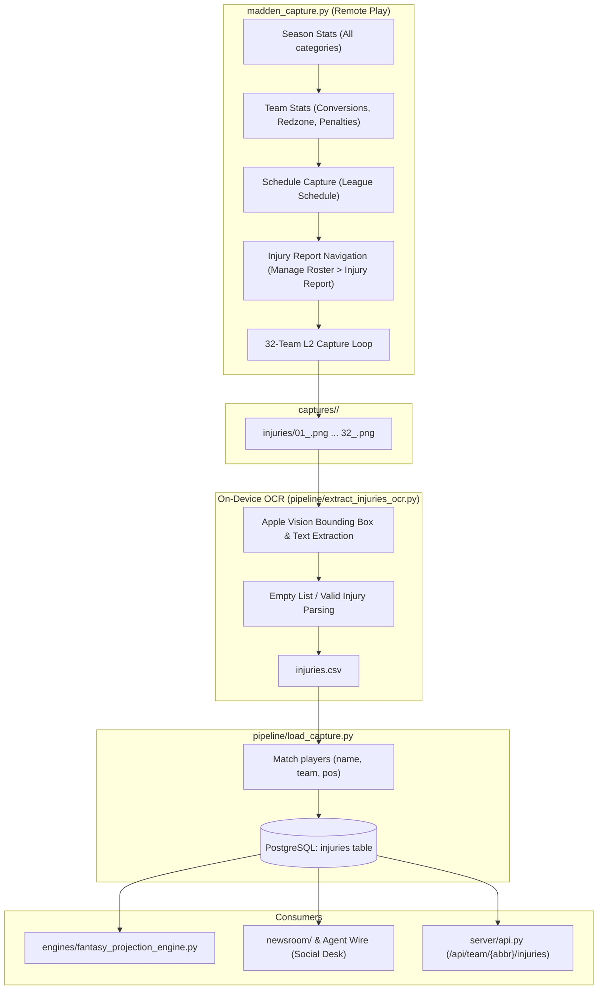

# Project Mu: Weekly Injury Extraction Pipeline Plan

## 1. System Overview & Objectives
This plan outlines the integration of weekly injury extraction into Project Mu's capture, OCR, and ingestion pipeline. Madden exposes an **Injury Report** screen under Franchise mode (`Manage Roster > Injury Report`). Unlike Player Stats or Team Stats, the Injury Report is scoped strictly by individual team without an all-NFL summary view.

### Key Characteristics & Requirements
1. **Zero Vertical Scrolling**: An NFL franchise's active injury list fits entirely on a single screen page (typically 0–12 players). No vertical list pagination is needed per team.
2. **Horizontal Team Navigation (`L2` cycling)**: Teams are cycled via `L2` presses.
3. **Local On-Device Apple Vision OCR**:
   - Verification: On-screen OCR detects team transitions and ensures exactly 32 distinct teams are captured.
   - Extraction: Because tables are clean and consistent, full field extraction (`PLAYER_NAME`, `POS`, `OVR`, `INJURY`, `DURATION`, `IR`) is performed on-device using macOS Apple Vision OCR (`VNRecognizeTextRequest`), requiring zero Gemini API calls or tokens.
4. **Resilience & Freeze Recovery**:
   - Up to 3 retries on dropped `L2` inputs.
   - Chiaki-ng stream freeze detection (`stream_frozen()`) and automatic process recovery (`recover_stream()`).
5. **Database Integration**:
   - Single weekly capture transaction populating an `injuries` table.
   - Direct integration into fantasy projections (inactive/IR players zeroed out) and newsroom/agent swarm reporting.

---

## 2. End-to-End Pipeline Architecture



---

## 3. Screen Navigation & Madden UI State

### 3.1 Screen Classification (`madden_capture.py`)
Add `INJURY_REPORT` to `classify(f)`:
- **Heuristics**:
  - Contains `"INJURY REPORT"` in the top banner/header.
  - Distinguishable from `ROSTER_LIST`: does not have contract columns (`SAVINGS`, `PENALTY`, `SPEAK WITH PLAYER`, `VIEW PLAYER CARD`).
  - Distinguishable from `PLAYER_STATS`: does not have category cycles (e.g. `PASSING`, `RUSHING`) or `DOWNS PLAYED`.
  - Column headers include: `NAME` (or `PLAYER`), `POS`, `OVR`, `INJURY`, `STATUS` / `LENGTH`.
- Added to `LIST_SCREENS` tuple so that `stream_frozen()` can execute safe Down/Up test presses if needed.

### 3.2 Navigation Route
1. From `League Schedule` (or upon starting `--only injuries`), call `go_hub()`.
2. Move tab selector to `MANAGE ROSTER` (`HUB_ROSTER`).
3. Move vertical menu selector to `"INJURY REPORT"` in `ROSTER_MENU`.
4. **Safety Enforcement**:
   - Update `cross(screen, frame)`: Cross is strictly prohibited unless `"INJURY REPORT"` is highlighted with light-background brightness verification (`highlighted(ROSTER_MENU) == "INJURY REPORT"`).
5. Call `cross_into("HUB_ROSTER", ["INJURY_REPORT"])`.

---

## 4. Capture Loop & Fault Tolerance

### 4.1 32-Team Capture Loop (`run_injuries`)
1. **Target Team Set**: `TEAMS` constant in `madden_capture.py` (32 normalized NFL team nicknames: `49ERS`, `BEARS`, ..., `VIKINGS`).
2. **Identification**:
   - Extract active team from the screen's team chip/header using Apple Vision OCR.
   - Verify `current_team in TEAMS`.
   - Store `first_team = current_team`.
3. **Capture Step**:
   - Save full screen frame as `captures/<run>/injuries/{index:02d}_{norm(current_team).lower()}.png`.
   - Add `current_team` to `seen_teams` set.
4. **Advancement via `L2`**:
   - Execute `press("l2", hold=0.15, wait=1.2)`.
   - Read screen OCR again to determine `new_team`.
5. **Retry Mechanism**:
   - If `new_team == current_team` (or team chip unread):
     - Wait `0.8s` and retry `press("l2", hold=0.15, wait=1.2)`.
     - Allow up to 3 retry attempts per transition.
6. **Freeze Detection & Recovery**:
   - If after 3 retries the screen remains unchanged:
     - Check `stream_frozen()`.
     - If frozen: invoke `recover_stream()`, which force-quits `chiaki-ng`, relaunches the stream (`CHIAKI_HOST` / `CHIAKI_HOST_IP`), re-navigates to `INJURY_REPORT`, reads the current team, and resumes without losing previously captured teams.
7. **Termination & Completeness Assertion**:
   - Loop runs until `len(seen_teams) == 32` or the sequence wraps back to `first_team`.
   - **Verification Check**:
     ```python
     if len(seen_teams) != 32:
         missing = TEAMS - seen_teams
         raise Abort(f"Injury capture incomplete: only {len(seen_teams)}/32 teams captured. Missing: {sorted(missing)}")
     ```

---

## 5. Local Apple Vision OCR Extractor

Located in `pipeline/extract_injuries_ocr.py`, called during the extraction stage (`extract.py` / `weekly_capture.py`).

### 5.1 Extraction Logic
1. **Input**: Directory `captures/<run>/injuries/`.
2. **Image Processing**:
   - For each screenshot, run `VNRecognizeTextRequest` with `VNRequestTextRecognitionLevelAccurate` and `usesLanguageCorrection = False`.
   - Normalize characters using `HOMOGLYPHS`.
3. **Row Clustering**:
   - Identify header line (`NAME`, `POS`, `OVR`, `INJURY`, `STATUS` / `LENGTH`).
   - Group text tokens below the header by vertical bounding box overlap ($y$-coordinate clustering).
4. **Empty Roster / No Injuries Handling**:
   - If a screen displays `"NO INJURIES"` or has zero rows below the table header, record 0 injury rows for that team. This is a valid state and must not trigger an error.
5. **Field Parsing**:
   - `TEAM`: Inferred from verified screenshot filename and on-screen team chip.
   - `PLAYER_NAME`: Player's display name, stripped of OCR noise.
   - `POSITION`: Must match standard NFL positions (`QB`, `HB`, `FB`, `WR`, `TE`, `LT`, `LG`, `C`, `RG`, `RT`, `LEDG`, `REDG`, `DT`, `SAM`, `MIKE`, `WILL`, `CB`, `FS`, `SS`, `K`, `P`).
   - `OVR`: Integer between 40 and 99.
   - `INJURY_TYPE`: Cleaned diagnosis text (e.g. `Torn ACL`, `Dislocated Hip`, `Hamstring Strain`, `Bruised Shoulder`).
   - `DURATION`: Raw string (e.g. `2 Weeks`, `Season`, `Doubtful`, `Questionable`).
   - `WEEKS_REMAINING`: Parsed integer (e.g. `2 Weeks` $\rightarrow 2$, `Season` $\rightarrow 18$, `Doubtful` $\rightarrow 1$).
   - `IS_IR`: Boolean flag indicating whether the player is placed on Injured Reserve.
6. **Output**: CSV written to `captures/<run>/injuries.csv`.

---

## 6. Database Schema & Migration

### 6.1 SQL Migration (`db/migrations/2026_11_07_injuries.sql`)
```sql
-- Project Mu: Weekly Injury Ledger
CREATE TABLE IF NOT EXISTS injuries (
    id SERIAL PRIMARY KEY,
    season INT NOT NULL,
    week INT NOT NULL,
    team_id INT NOT NULL REFERENCES teams(id) ON DELETE CASCADE,
    player_id INT REFERENCES players(id) ON DELETE SET NULL,
    player_name VARCHAR(255) NOT NULL,
    position VARCHAR(10),
    ovr INT,
    injury_type VARCHAR(100),
    duration VARCHAR(50),
    weeks_remaining INT,
    is_ir BOOLEAN DEFAULT FALSE,
    captured_at TIMESTAMP WITH TIME ZONE DEFAULT NOW(),
    UNIQUE(season, week, player_id)
);

CREATE INDEX IF NOT EXISTS idx_injuries_season_week ON injuries(season, week);
CREATE INDEX IF NOT EXISTS idx_injuries_team ON injuries(team_id);
CREATE INDEX IF NOT EXISTS idx_injuries_player ON injuries(player_id);
```

### 6.2 Data Ingestion (`pipeline/load_capture.py`)
- Reads `captures/<run>/injuries.csv`.
- Maps each row to `players.id` using `(team_id, player_name, position)` fuzzy matching via `pipeline/capture_matching.py`.
- Executes transactional `UPSERT` into `injuries`.

---

## 7. Downstream System Utilization

### 7.1 Fantasy Analytics (`engines/fantasy_projection_engine.py`)
- Query `injuries` for `current_season` and `current_week`.
- Any player with `is_ir = TRUE` or `weeks_remaining > 0`:
  - Set `projected_points = 0.0`.
  - Set `pos_rank = NULL`.
  - Supply injury status metadata to the frontend (`IR`, `OUT`).

### 7.2 Newsroom & Agent Swarm
- Update `newsroom/db_tools.py` with an `injury_report` query tool.
- Feed injury summaries into:
  - Game preview briefs (e.g. "Starting QB ruled out for 4 weeks with a broken collarbone").
  - Beat reporter memory entries and hot takes.
  - Social desk posts (e.g. die-hard fan reactions to star player injuries).

### 7.3 REST API Endpoints (`server/api.py`)
- `GET /api/injuries?season={season}&week={week}&team={abbr}`: Returns league-wide or team-filtered injury reports.
- `GET /api/player/{id}`: Add active injury badge and recovery timeline to player cards.

---

## 8. Git Workflow & Branching Strategy

Per Project Mu development standards:
1. **Feature Branch Isolation**:
   - All implementation work for this feature must take place on an isolated feature branch (e.g. `feat/weekly-injuries`).
   - Any existing uncommitted changes on `main` must remain completely untouched.
2. **Commit & Merge to `main`**:
   - Whenever a commit is made on the feature branch, check out `main` and merge the branch in right away.
   - If the merge encounters a conflict, stop and alert the user immediately without attempting automated conflict resolution.
   - Do not push to remote unless explicitly requested.

---

## 9. Implementation Steps & Verification Checklist

1. **Step 1: Branch Setup & Screen Exploration**
   - Create and check out `feat/weekly-injuries`.
   - Run `python3 madden_capture.py --step none` and `--probe-l2` on the `INJURY REPORT` screen to verify screen coordinates, team chip OCR anchor, and `L2` tap behavior.
2. **Step 2: Navigation & Capture Mode (`madden_capture.py`)**
   - Implement `classify()` rules for `INJURY_REPORT`.
   - Implement `run_injuries(out)` with the 32-team capture loop, retry mechanism, and stream freeze fallback.
   - Add CLI flag `--only injuries`.
3. **Step 3: Apple Vision Extractor (`pipeline/extract_injuries_ocr.py`)**
   - Build and test local OCR extraction against saved screenshots.
   - Validate against edge cases (teams with 0 injuries, IR badges, multiline text).
4. **Step 4: Database Migration & Loader Integration**
   - Apply `db/migrations/2026_11_07_injuries.sql`.
   - Integrate into `pipeline/load_capture.py` and `pipeline/weekly_capture.py`.
5. **Step 5: Documentation Synchronization & Mainline Merge**
   - Update `PROJECT_SPEC.md` reflecting the new table, CLI options, pipeline sequence, and repository layout.
   - Merge `feat/weekly-injuries` into `main`.
