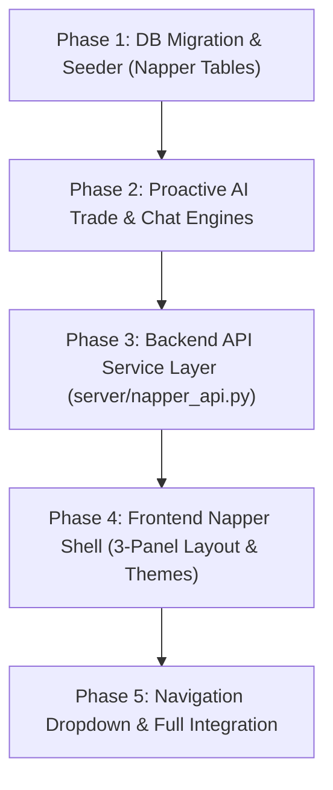

# Project Mu: "Napper" — Interactive Fantasy League Platform
## Architectural Specification & Implementation Plan


---

## 1. Executive Summary & Product Vision

### What is Napper?
**Napper** (a playful nod to Sleeper) is Project Mu's fully interactive, multi-league fantasy football simulation platform. While **Mu Fantasy Analytics** (`#fantasy`) serves as the quantitative and editorial command center (rankings, ADP, article analysis, SOS matchup stars), **Napper** (`#napper`) is the playable fantasy software experience.

### Key Architectural Decisions
1. **Dedicated Application Experience (`#napper`)**:
   - Like Sleeper and Discord, Napper runs in a distinct 3-panel dark desktop shell (`#131a27` slate-navy with `#00ceb8` cyan accents) designed for high-density roster management, live scoreboards, and active chat streams.
2. **Unified "Fantasy" Navigation Dropdown**:
   - In both the primary Gridiron shell header and the internal sub-headers, the top-level **"Fantasy"** link becomes an interactive dropdown menu with two clean destinations:
     - **Analytics** (`#fantasy`): Editorial front page, Morning Huddle, weekly rankings, ROS board, preseason ADP, and defensive matchup stars.
     - **Napper** (`#napper` or `#napper-{leagueId}`): The playable fantasy leagues hub (matchups, lineups, trades, waivers, and AI league banter).
3. **Proactive, Living AI Leagues (Not Just Reactive)**:
   - Leagues in Napper feel genuinely alive. AI managers are autonomous agents with distinct manager personas (e.g. *The Trade Fiend*, *The Waiver Hawk*, *The Nostalgic Die-Hard*, *The Zero-RB Zealot*).
   - **AI-Initiated Trades**: AI managers actively analyze roster surplus vs. deficits (e.g. an excess of top-15 QBs with a dire need at RB2) and propose balanced, advantageous trades to other AI managers and to the user.
   - **Active League Chat & Banter**: AI managers don't wait to be spoken to. They trash-talk their weekly opponent, complain about injuries, react to trades and waiver results, and banter with the automated league awards bot.

---

## 2. Navigation & Header Integration

### A. Primary Gridiron Shell (`Mu_Network/src/App.tsx`)
The standard site navigation is updated:
```
[ GRIDIRON ]  Teams ▾   Stats ▾   Standings   Schedule   [ Fantasy ▾ ]   Social
                                                              │
                                            ┌─────────────────┴─────────────────┐
                                            ▼                                   ▼
                                      📊 Analytics                        🛏️ Napper
                                   (Mu Fantasy Home)             (Playable Fantasy Leagues)
                                     `#fantasy`                          `#napper`
```
- Hovering or clicking **Fantasy** displays a sleek, styled dropdown card previewing:
  - **Analytics**: *"Consensus rankings, rest-of-season projections, editorial analysis & ADP."*
  - **Napper**: *"Your fantasy leagues, live head-to-head matchups, trades, and league chat."* (Displays active league badges and your current matchup score).

### B. Mu Fantasy Analytics Header (`FantasyHeader`)
- Retains the "NFL" escape link back to Gridiron.
- The header includes a direct quick-switch tab or dropdown to jump straight into **Napper**.

### C. Napper Shell Navigation
- The top header of Napper features:
  - Napper brand mark & active league title (`"Solo 2026 8-Team SF PPR"`).
  - Quick-switch link back to **"Mu Analytics"** (`#fantasy`) and **"NFL Gridiron"** (`#`).
  - League Settings gear icon `[⚙]`.

---

## 3. The 3-Panel Napper Desktop Architecture

```
┌─────────────────┬─────────────────────────────────────────────────┬───────────────────────────┐
│ 1. LEFT RAIL    │ 2. CENTER STAGE (League Hub)                    │ 3. RIGHT RAIL             │
│                 │                                                 │                           │
│ • Napper Brand  │ • Header: [Icon] Solo 2026 8-Team SF PPR  [⚙]    │ • Header: League Chat 📌🔔│
│   (Pillow/Moon) │ • Nav Tabs: MATCHUP | TEAM | LEAGUE | PLAYERS   │                           │
│ • Direct Msgs(2)│             TREND | TRADES | SCORES             │ • Automated Bot Cards:    │
│ • Inbox (Alerts)│─────────────────────────────────────────────────│   - RB Benchwarmer of Week│
│ • LEAGUES (+)   │ [MATCHUP VIEW ACTIVE]                           │     (Aaron Jones card)    │
│   - Solo (Live) │ • Matchup Banner:                               │   - WR Benchwarmer of Week│
│   - Justice Lg  │   @jrereyi2000 (Straw Hats) vs Team 3           │     (@jrereyi2000 / Puka) │
│   - The Avengers│   Win Prob (76% vs 24%) | Proj (152.1 vs 113.9) │   - High Scorer Award     │
│                 │ • Week Selector: [ Wk. 6 ▾ ]                    │                           │
│ • User Profile  │ • Starters Comparison Table:                    │ • AI Manager Banter:      │
│   @jrereyi2000  │   [Player L] [Pts] [SLOT] [Pts] [Player R]      │   "Puka on my bench... 😭"│
│   [Avatar] [⚙]  │   Allen  24.95     QB    18.45  Prescott        │   "Good luck @jrereyi"    │
│                 │   Love    0.00     RB    22.76  Walker          │ • Input: [+] [GIF] [Text] │
└─────────────────┴─────────────────────────────────────────────────┴───────────────────────────┘
```

### Panel 1: Left Navigation Rail
- **Branding**: Napper logo (stylized pillow/moon icon with teal glow).
- **Direct Messages & Inbox**: Unread badges for incoming trade offers and direct messages from other managers.
- **Leagues Directory**:
  - Vertical list of all leagues the user belongs to.
  - Each item shows the custom league badge, league name (`Solo`, `The Justice League`, `The Avengers`), current live score (`152.14 vs 113.95`), and season phase (`IN SEASON`, `• PRE DRAFT`).
  - Active league highlighted with teal edge indicator.
  - **`(+)` Action Button**: Modal to **Create a Custom League** (8/10/12-team, PPR/Half/Standard, Superflex) or **Join an AI Simulation League** (instantly claim a franchise in one of the 100 simulation leagues from `engines/fantasy_league_sim.py`).
- **User Profile Footer**:
  - Avatar, handle (`@jrereyi2000`), trophy count, and profile settings modal.

### Panel 2: Center Stage — The 7 Core Tabs
1. **`MATCHUP` (The Core Screen)**:
   - **Versus Header**:
     - Left Team: Avatar, manager handle (`@jrereyi2000`), team name (`The Straw Hat Pirates`), W-L record (`5-0`), live points (`-` or `152.14`), projected total (`152.14`), win probability bar (`76%`).
     - Center: `VS` indicator.
     - Right Team: Avatar, team name (`Team 3`), W-L record (`4-1`), live points (`25.40`), projected total (`113.95`), win probability bar (`24%`).
     - Subtitle meta: *"Yet to play (10) 2 QB, 2 RB, 4 WR, 2 TE"* vs *"Yet to play (9) 2 QB, 2 RB, 4 WR, TE"*.
   - **Week Selector Dropdown**: Switch between `Wk. 1` and `Wk. 17`.
   - **Starters Split-Column Table**:
     - Left column: Headshot, player name (`J. Allen`), position & team (`QB - BUF`), game time/opponent (`Sun 4:25 PM @ LV`), live/projected points (`24.95`).
     - Center slot badges: `QB`, `RB`, `RB`, `WR`, `WR`, `TE`, `FLEX`, `SUPERFLEX`, `K`, `DEF`.
     - Right column: Opposing starter details mirrored (`D. Prescott`, `QB - DAL`, `18.45`).
   - **Bench Matchup Section**: Collapsible bench comparison underneath starters.
2. **`TEAM` (Roster Management & Lineup Optimizer)**:
   - Complete team roster segmented into Starters, Bench, and IR/Taxi.
   - Interactive lineup editing: Swap bench players into starting or FLEX positions with automatic position-eligibility validation.
   - One-click access to the full **Fantasy Player Modal** for stats, projections, and outlook.
3. **`LEAGUE` (Standings & Playoff Brackets)**:
   - Full standings table: Rank, Team Name, Manager, Record (W-L-T), Points For (PF), Points Against (PA), Streak, Playoff Seed.
   - Interactive 6-team playoff bracket (Weeks 15–17).
   - League Constitution & settings overview.
4. **`PLAYERS` (Waiver Wire & Free Agency)**:
   - Filterable free agent pool (`ALL`, `QB`, `RB`, `WR`, `TE`, `K`, `DEF`).
   - Sorted by weekly projection, season average, rest-of-season rank, or % rostered.
   - **Claim / Add Button**: Opens drop selection modal.
5. **`TREND` (Market Intelligence)**:
   - Most added / most dropped players across the league over the past 48 hours.
   - ADP risers and fallers.
6. **`TRADES` (Active Trade Hub)**:
   - **Incoming Offers**: Trade proposals sent to you by AI managers, with proposed players, net projected ROS impact, and Accept/Reject/Counter actions.
   - **Propose a Trade**: Interactive trade builder to assemble multi-player offers with any team.
   - **Trade Block**: Flag players on your roster as "On the Block" or specify positions of need.
   - **League-Wide Trade Log**: Completed trades between AI managers.
7. **`SCORES` (League Scoreboard)**:
   - Weekly grid of all head-to-head matchups across the league with live scoring.

### Panel 3: Right Rail — Autonomous League Chat & AI Banter
- **Automated League Bot Cards**:
  - **"RB / WR / TE Benchwarmer of the Week"**: Spotlights the manager who benched the highest-scoring player (e.g. Aaron Jones 18.2 FPTS, Puka Nacua 37.7 FPTS) with stat cards.
  - **"High Scorer of the Week"** and **"Heartbreaker of the Week"** (loss by < 2.0 pts).
  - **"Waiver Wire Summary"** and **"Trade Alert"** announcements.
- **Autonomous AI Manager Banter**:
  - AI managers converse in chat, commenting on their own matchups, laughing at benchwarmers, reacting to trades, and trash-talking upcoming opponents.
- **Interactive User Chat**:
  - Full chat input with (+) attachments, GIF search, emoji picker, and send button.

---

## 4. Proactive AI Manager Engine Architecture

To ensure leagues feel truly active rather than passive, we introduce two autonomous engines:

### A. Proactive Trade Engine (`engines/napper_trade_engine.py`)
AI managers do not simply wait for the user to initiate trades. On a weekly cadence (particularly between Weeks 4 and 11):
1. **Roster Audit**:
   - Each AI manager calculates positional strength using Rest-of-Season projections (`ros_total_points`) and starter requirements.
   - Identifies **Surpluses** (e.g. having QB1 and QB7 when only 1 QB starts) and **Deficits** (e.g. RB2 is RB42).
2. **Partner Matching**:
   - The engine scans all other teams in the league (including the user's team) for complementary needs.
   - If Team A has surplus QB / deficit RB, and Team B (or user) has surplus RB / deficit QB, a mutually beneficial trade package is formulated.
3. **Proposal Dispatch**:
   - For user trades: A formal proposal is dispatched to the user's Inbox and `TRADES` tab, complete with a natural-language pitch from the AI manager in chat (e.g., *"Sent you an offer @jrereyi2000 — I'm deep at receiver and need backfield help"*).
   - For AI-to-AI trades: The engine evaluates mutual benefit with stochastic acceptance; approved trades execute and post an announcement to the League Chat.

### B. Autonomous League Chat Engine (`engines/napper_chat_engine.py`)
Generates realistic, contextual chat traffic driven by game outcomes:
1. **Event Triggers**:
   - **Tuesday Morning (Post-Week Recap)**: Bot posts Benchwarmers & High Scorer. AI managers react (e.g., self-deprecating remarks on benched stars).
   - **Wednesday Morning (Waiver Processing)**: Bot posts waiver results. Managers react to bids and missed claims.
   - **Thursday/Sunday Kickoff (Game Day)**: Pre-game trash talk between matched-up managers.
   - **Trade Execution**: Comments on trades (*"Fair deal"*, *"Highway robbery"*, etc.).
2. **Personality Archetypes**:
   - *The Trash Talker*: Cocky when winning, makes excuses when losing.
   - *The Analytics Nerd*: Cites expected points, target shares, and bad luck.
   - *The Waiver Hawk*: Constantly churning the bottom of their roster.
   - *The Die-Hard*: Overvalues players from their favorite NFL franchise.

---

## 5. Database Schema (`db/migrations/2026_12_02_napper_fantasy.sql`)

```
┌────────────────────────────────────────────────────────┐
│                    napper_user_profiles                │
│ id (PK) | handle | display_name | avatar_url | created_at│
└───────────────────────────┬────────────────────────────┘
                            │ 1:N
┌───────────────────────────▼────────────────────────────┐
│                       napper_leagues                   │
│ id (PK) | name | season | teams_count | scoring_type    │
│ roster_format (jsonb) | current_week | status | avatar │
└───────────────────────────┬────────────────────────────┘
                            │ 1:N
┌───────────────────────────▼────────────────────────────┐
│                        napper_teams                    │
│ id (PK) | league_id | user_id (NULL for AI) | team_name│
│ manager_handle | avatar_url | is_ai | persona | wins   │
│ losses | ties | points_for | points_against | seed     │
└───────────────────────────┬────────────────────────────┘
         ┌──────────────────┼──────────────────┬─────────────────┐
         │ 1:N              │ 1:N              │ 1:N             │ 1:N
┌────────▼──────────┐ ┌─────▼──────────┐ ┌─────▼──────────┐ ┌────▼───────────┐
│   napper_rosters  │ │  napper_matchup│ │ napper_trades  │ │  napper_chat   │
│ id | league_id    │ │ id | league_id │ │ id | league_id │ │ id | league_id │
│ team_id | week    │ │ week | home_id │ │ proposer_team  │ │ sender_type    │
│ player_id | slot  │ │ away_id | score│ │ target_team    │ │ sender_name    │
│ (QB, RB1, BN, etc)│ │ proj | win_prob│ │ offer/request  │ │ text | card_json│
└───────────────────┘ └────────────────┘ │ status (PENDING)│ └────────────────┘
                                         └────────────────┘
```

### Table Specifications
1. **`napper_user_profiles`**:
   - `id SERIAL PRIMARY KEY`, `handle VARCHAR(32) UNIQUE` (e.g. `'jrereyi2000'`), `display_name VARCHAR(64)`, `avatar_url TEXT`, `created_at TIMESTAMPTZ DEFAULT NOW()`.
   - Seeded with default profile `@jrereyi2000` ("The Straw Hat Pirates").
2. **`napper_leagues`**:
   - `id SERIAL PRIMARY KEY`, `name VARCHAR(64)` (`'Solo 2026 8-Team SF PPR'`), `season INT DEFAULT 2035`, `teams_count SMALLINT` (8, 10, 12), `scoring_type VARCHAR(16)` (`'PPR'`, `'HALF_PPR'`, `'STANDARD'`), `roster_format JSONB`, `status VARCHAR(16)`, `avatar_url TEXT`.
3. **`napper_teams`**:
   - `id SERIAL PRIMARY KEY`, `league_id INT REFERENCES napper_leagues(id) ON DELETE CASCADE`.
   - `user_id INT REFERENCES napper_user_profiles(id) ON DELETE SET NULL`.
   - `team_name VARCHAR(64)`, `manager_handle VARCHAR(32)`, `avatar_url TEXT`, `is_ai BOOLEAN DEFAULT FALSE`.
   - `persona VARCHAR(32)` (`TRASH_TALKER`, `ANALYTICS_NERD`, `WAIVER_HAWK`, `DIE_HARD`).
   - `wins INT`, `losses INT`, `ties INT`, `points_for NUMERIC(8,2)`, `points_against NUMERIC(8,2)`, `seed SMALLINT`.
4. **`napper_rosters`**:
   - `id SERIAL PRIMARY KEY`, `league_id INT`, `team_id INT`, `week INT`, `player_id INT REFERENCES players(id)`, `slot VARCHAR(16)`.
   - Unique constraint on `(team_id, week, player_id)`.
5. **`napper_matchups`**:
   - `id SERIAL PRIMARY KEY`, `league_id INT`, `week INT`, `home_team_id INT`, `away_team_id INT`.
   - `home_score NUMERIC(6,2)`, `away_score NUMERIC(6,2)`, `home_proj NUMERIC(6,2)`, `away_proj NUMERIC(6,2)`, `win_prob_home NUMERIC(4,3)`, `is_final BOOLEAN DEFAULT FALSE`.
6. **`napper_trades`**:
   - `id SERIAL PRIMARY KEY`, `league_id INT`, `week INT`, `proposer_team_id INT`, `target_team_id INT`.
   - `offered_player_ids INT[]`, `requested_player_ids INT[]`.
   - `status VARCHAR(16)` (`'PENDING'`, `'ACCEPTED'`, `'REJECTED'`, `'EXPIRED'`, `'COUNTERED'`).
   - `initiated_by_ai BOOLEAN DEFAULT FALSE`, `ai_rationale TEXT`, `created_at TIMESTAMPTZ DEFAULT NOW()`.
7. **`napper_chat`**:
   - `id SERIAL PRIMARY KEY`, `league_id INT`, `sender_type VARCHAR(16)` (`'USER'`, `'AI_MANAGER'`, `'SYSTEM_BOT'`).
   - `sender_name VARCHAR(64)`, `sender_handle VARCHAR(32)`, `avatar_url TEXT`, `message_text TEXT`, `card_payload JSONB`, `created_at TIMESTAMPTZ DEFAULT NOW()`.

---

## 6. Backend API Specifications (`server/napper_api.py`)

Mounted under `/api/napper/*`:

| Method | Endpoint | Description |
|---|---|---|
| `GET` | `/api/napper/profile` | Current user profile, active leagues, pending trade count |
| `GET` | `/api/napper/leagues` | All leagues for user with live matchup scores and record |
| `POST` | `/api/napper/leagues/create` | Create a custom league (format, teams, rules) |
| `POST` | `/api/napper/leagues/join-sim/{num}` | Clone or join one of the 100 simulation leagues |
| `GET` | `/api/napper/league/{id}` | League details, settings, and standings |
| `GET` | `/api/napper/league/{id}/matchup?week={week}` | Starter-by-starter matchup comparison, points & win prob |
| `POST` | `/api/napper/league/{id}/lineup` | Move players between starters and bench (`{team_id, swaps}`) |
| `GET` | `/api/napper/league/{id}/waivers` | Available free agents with projections, average, and ROS |
| `POST` | `/api/napper/league/{id}/waivers/claim` | Submit an add/drop transaction |
| `GET` | `/api/napper/league/{id}/trades` | Pending trade offers (incoming & outgoing), trade block |
| `POST` | `/api/napper/league/{id}/trades/propose` | Propose a trade (user or AI) |
| `POST` | `/api/napper/league/{id}/trades/{id}/respond` | Accept or reject a trade proposal |
| `GET` | `/api/napper/league/{id}/chat` | League chat feed, bot award cards, and manager messages |
| `POST` | `/api/napper/league/{id}/chat/send` | Post a user message to the league chat |
| `POST` | `/api/napper/league/{id}/simulate-ai-trades` | Trigger weekly AI trade scans and proactive proposals |

---

## 7. Phased Implementation Roadmap



### Phase 1: Database Migration & Baseline Seeding
- Create `db/migrations/2026_12_02_napper_fantasy.sql` defining all 7 `napper_*` tables.
- Create `engines/napper_seeder.py`:
  - Seeds profile `@jrereyi2000` ("The Straw Hat Pirates").
  - Seeds the 3 reference leagues:
    1. **`Solo 2026 8-Team SF PPR`** (Your team, Week 6 matchup vs Team 3 with starters matching the screenshot).
    2. **`The Justice League`** (12-team PPR).
    3. **`The Avengers`** (8-team Dynasty PPR, Pre-Draft).
  - Populates full schedules, initial rosters, and starter slots.

### Phase 2: Proactive AI Trade & Chat Engines
- Build `engines/napper_trade_engine.py`:
  - Evaluates roster surplus/deficits and dispatches AI-initiated trade offers to the user and other teams.
- Build `engines/napper_chat_engine.py`:
  - Generates weekly Benchwarmer of the Week award cards and triggers contextual AI manager banter.

### Phase 3: Backend API
- Build `server/napper_api.py` and register with FastAPI in `server/api.py`.
- Add test suite in `tests/test_napper_api.py` covering matchups, lineup swaps, trade proposals, and chat delivery.

### Phase 4: Frontend Napper Page (`Mu_Network/src/NapperPage.tsx`)
- Build the 3-panel layout in `NapperPage.tsx` with dedicated styling in `Mu_Network/src/napper.css`:
  - Left rail: Leagues list, active match preview, user profile footer.
  - Center stage: Header with settings gear and the 7 tabs (`MATCHUP`, `TEAM`, `LEAGUE`, `PLAYERS`, `TREND`, `TRADES`, `SCORES`).
  - Right rail: Rich league chat with award cards and interactive input.
- Match the exact visual hierarchy from the reference screenshot.

### Phase 5: Navigation Dropdown & Route Integration
- Update the main Gridiron shell header in `Mu_Network/src/App.tsx`:
  - Convert **"Fantasy"** into an interactive dropdown with **"Analytics"** (`#fantasy`) and **"Napper"** (`#napper`).
- Update `FantasyHeader` to include a quick-switcher to Napper.
- Register hash routes `#napper` and `#napper-{leagueId}`.
- Update `PROJECT_SPEC.md` and `Mu_Network/PROJECT_SPEC.md`.

---

## 8. Verification & Success Criteria

1. **Active AI Trades**: The user opens the `TRADES` tab and sees realistic trade proposals initiated by AI managers seeking to fill their roster holes.
2. **Dynamic Chat & Awards**: Tuesday simulations generate visible "Benchwarmer of the Week" cards in the chat rail, followed by realistic AI manager reactions.
3. **Smooth Navigation**: The top-level "Fantasy" dropdown effortlessly directs users to either quantitative analytics (`#fantasy`) or the playable league experience (`#napper`).
4. **Starter Swaps**: Changing a starter in the `TEAM` tab immediately recalculates the projected points, live score, and win probability in the `MATCHUP` view.
5. **Zero Regressions**: All existing newsroom articles, player profiles, standings, and Mu Fantasy Analytics remain 100% operational.
