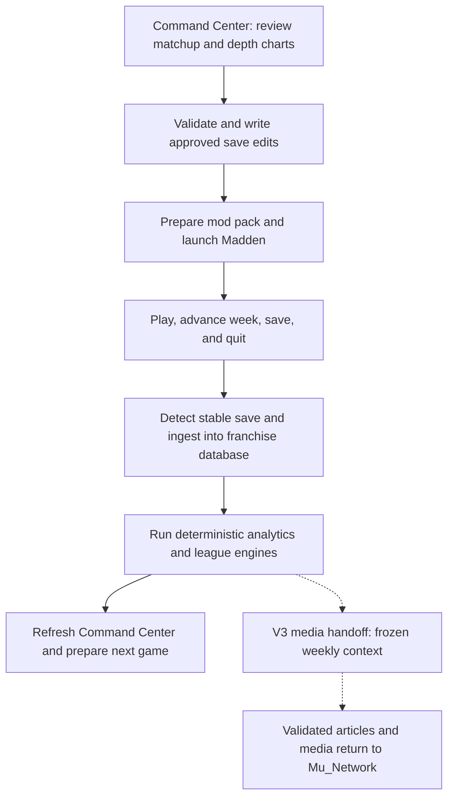

# Project Mu: V2 Master Plan — The Franchise Operating System

**Status (2026-11-02):** Approved architecture for the local franchise operating system. V2 owns headless Madden, front-office control, progression, and the Franchise Command Center. Cloud media, dossier-based writing, multimedia, and conversational Napper enhancements are separately planned in [`V3_STUDIO_PLAN.md`](./V3_STUDIO_PLAN.md). **The §7.1 build roadmap (Phases 1–5) is built and on main** through [`V2_CORE_BUILD_PLAN.md`](../done/V2_CORE_BUILD_PLAN.md) (2026-11-02); what remains is live-league validation, progression going live, and the unbuilt features listed in §7.3.
**Approach (JR, 2026-11-02):** JR never uses Madden's menus. Project Mu handles every franchise function, and "Play Game" boots straight into the game (§8, formerly a stretch goal), so Madden is only ever seen on the field. Anything that exists only to show Project Mu data inside Madden's menus is dropped (V2.1).
**Delivery boundary:** V3 media production is not an additional prerequisite for starting the live franchise (2026 Madden start, §7.2); the existing V2 readiness requirement below remains in force. This is a documentation split, not a completed runtime migration.
**Prerequisite:** The PC environment, save reader/writer, and Docker Postgres are operational ([`PC_MIGRATION_PLAN.md`](../done/PC_MIGRATION_PLAN.md) §3, §5).
**Strategic Decision (JR, 2026-10-29; start updated 2026-10-30):** The live **canonical franchise run is held until V2 systems are fleshed out and tested** on scratch/sample saves (`CAREER-WEEK1/2/3` and `CAREER-GIANTS-AUTOSAVE`). The Madden franchise then starts in 2026 and Project Mu runs it as a fully CPU league through 2033 before JR takes over a team in 2034 (§7.2, V2's final milestone). Testing V2 first ensures that when the permanent league begins, progression, coach-set depth charts, and CBA contract mechanics are fully autonomous and controlled by Project Mu rather than Madden's native CPU algorithms.

---

## 1. Executive Summary: Headless Madden & Project Mu as the NFL OS

In the PS5 era (v1), Project Mu was an observational chronicler: Madden ran the simulation and made all front-office decisions, while Project Mu passively parsed screens via OCR to tell stories.

In **V2**, the relationship is completely inverted:
* **Project Mu is the Operating System of the NFL Universe:** It owns all league state, player development, deterministic analytics, trades, contract negotiations, free agency, the college draft, weekly game planning, and depth charts across all 32 teams.
* **Madden 27 is a Headless 60-Minute Physics Engine:** Madden is never used for menus, franchise management, or CPU transactions. Its sole function is to load a pre-configured save, simulate or play the 60 minutes of on-field football physics, write the resulting stats to disk, and exit.

| Dimension | Legacy PS5 Setup (v1) | V2 Architecture |
| :--- | :--- | :--- |
| **Primary System Authority** | Madden Franchise Engine | **Project Mu Platform** |
| **Front Office & Roster Moves** | Madden CPU / Manual controller clicks | **Project Mu Autonomous GM Agents & Engines** |
| **Depth Charts** | Madden auto-sorting | **Project Mu Coach AI (32 Teams) + User Command Center** |
| **Player Development** | Madden XP sliders | **Deterministic Mu Progression Engine** ([`engines/progression.py`](../../engines/progression.py)) |
| **Contract Rules & Economics** | Madden arcade contracts | **Strict Real-Life NFL CBA Mechanics** (Tags, 5th-Year Options, Dead Money) |
| **Free Agency** | One-click instant accept | **Multi-Dimensional Agent Negotiation & Utility Scoring** |
| **Game Day Experience** | Navigating Madden menus | **One-click "Play Game" from `Mu_Network` Command Center** |

---

## 2. The Franchise Command Center (`Mu_Network`)

Rather than relying on Madden's franchise screens, the React 19 + Vite frontend (`Mu_Network`) features a dedicated, comprehensive **Franchise Command Center** (e.g. `/franchise`). This serves as the user's personal war room as Head Coach and General Manager.

```
┌─────────────────────────────────────────────────────────────────────────────────┐
│                          FRANCHISE COMMAND CENTER                               │
│  [Game Center]  [Depth Chart]  [Roster & Cap]  [Free Agency]  [Contract Room]   │
│                 [Trade Machine]  [Draft & Scouting]  [Training Room]            │
└─────────────────────────────────────────────────────────────────────────────────┘
```

### 2.1 Module 1: Game Center (Weekly Opponent Prep & One-Click Launch)
* **Opponent Scouting Dossier:** Record, offensive/defensive rankings (EPA, pass/rush splits), personnel groupings, weather conditions, and the newsroom’s matchup primer.
* **Matchup Breakdown:** Head-to-head positional battles (e.g. your Pass Rush vs their LT, your Slot WR vs their Nickel CB).
* **Game Strategy & Focus:** Set weekly offensive/defensive focuses (e.g. Blitz-heavy vs Cover-3; Inside Zone vs Deep Shot; stamina/fatigue management).
* **Post-Game Coverage Status:** Show ingestion and publication progress, with a link to the newsroom. Generation modes and provider selection belong to [V3 §3](./V3_STUDIO_PLAN.md#3-generation-and-publication-flow); V2 must remain usable while media is pending or unavailable.
* **The "Play Game" Trigger:**
  1. Pre-flight check: validates and writes pending depth charts, roster moves, and injuries to the save.
  2. Compiles and activates the game's tailored mod pack via [`pipeline.mod_packs`](../../pipeline/mod_packs.py) (CBS/FOX/Primetime presentation and scorebugs, crowd density tier, mudded or BCA pink ball).
  3. Triggers `MMCModManager.exe -launch <pack>` ([`pipeline/game_launch.py`](../../pipeline/game_launch.py), `POST /api/franchise/{abbr}/game/launch`; built).
  4. Boots straight into the user's game, so JR never navigates Madden's menus (§8; not built yet).

### 2.2 Module 2: Depth Chart & Situational Roles
* **Visual Interactive Grid for All 35 Positions:**
  - **Base Offense/Defense:** QB, HB, FB, WR (WR1, WR2, WR3), TE, LT, LG, C, RG, RT, LE, RE, DT, LOLB (SAM), MLB (MIKE), ROLB (WILL), CB, FS, SS.
  - **Situational / Specialists:** 3rd Down RB (3DRB), Slot WR (3DWR), Slot CB, Sub LB, Rush LE, Rush RE, Rush DT, Kick/Punt Returners, Long Snapper.
* **Drag-and-Drop / Click-to-Swap:** Real-time visual re-ordering.
* **Coach AI Auto-Sort:** "Let Staff Set" button runs deterministic coaching logic based on scheme fit, stamina, and coach philosophy (from [`PERSONALITY_PLAN.md`](./PERSONALITY_PLAN.md)).
* **Direct Save Sync:** Writes directly to `Team.DepthChart` (each of the 35 positions points to a 6-slot `Player[]` record in the save).

### 2.3 Module 3: Roster Construction & Cap Sheet
* **Roster Sections:** Active 53/65 Roster, Practice Squad (12–16 slots), and Injured Reserve (IR).
* **Financial Cap Sheet (Live & 5-Year Outlook):** Real-time breakdown of Total Cap, Cap Room, Salaries, Dead Money, and Rookie Reserve ([`server/front_office_api.py`](../../server/front_office_api.py)).
* **Roster Moves with Financial Safety Warnings:**
  - **Cut Player:** Displays exact **Cap Savings** vs **Dead Money Penalty** before confirmation. Warns if dead money acceleration results in negative cap savings.
  - **Practice Squad:** Promote to active roster or demote to practice squad (with eligibility validation).
  - **Injured Reserve:** Place eligible injured players on IR to open active roster spots.

### 2.4 Module 4: Free Agency & Waivers
* **Searchable Market Browser:** Filter all unassigned players across the league by position, OVR, age, scheme fit, and dev trait.
* **Interactive Negotiations:** Not a one-click transaction. Free agents negotiate based on financial offers, depth chart opportunity, and team competitiveness (see §3 below).
* **Waiver Wire:** Weekly waiver claims processed in inverse standings order before players clear to unrestricted free agency.

### 2.5 Module 5: Contract Room (In-Season Extensions & Cap Management)
* **Expiring Contracts Watchlist:** Highlights players in their contract year eligible for extension under NFL CBA rules.
* **Interactive Agent Negotiation:** Propose years, total money, and signing bonus. Player agents evaluate offers in real time and return acceptances, rejections, or counter-demands.
* **Restructure Tool:** Convert non-guaranteed base salary into signing bonus to create immediate cap space, showing the exact future dead money risk.

### 2.6 Module 6: Trade Machine & Trade Block
* **Two-Way Trade Machine:** Add players and future draft picks (next 3 drafts) from both sides.
* **Real-Time Surplus Value Bar:** Powered by [`engines/trade_value.py`](../../engines/trade_value.py), evaluating player surplus value ($V_T$) and pick curves.
* **Cap Verification:** Confirms both teams can legally absorb the incoming contracts and charges dead money to the trading team.
* **AI GM Dialogue:** AI GMs review proposals using personality traits, team direction (Contend / Retool / Rebuild), and positional needs ([`engines/gm_negotiation.py`](../../engines/gm_negotiation.py)).
* **Trade Block:** Place user players on the block and view CPU trade targets and rumors.

### 2.7 Module 7: College Scouting & Draft War Room
* **Consensus & Team Scouting Boards:** Track scouted prospects, archetype grades, combine metrics, and scout notes ([`engines/scouting_boards.py`](../../engines/scouting_boards.py), [`server/draft_api.py`](../../server/draft_api.py)).
* **Draft Capital Ledger:** Track all owned picks across 7 rounds for the next 3 draft classes.
* **Live War Room (Offseason):** Interactive draft board to make user picks while AI GMs execute deterministic picks based on their team boards.

### 2.8 Module 8: Training Room & Medical
* **Detailed Medical Ledger:** Track injury types, recovery timelines (weeks remaining), and game status (Out, Doubtful, Questionable).
* **Return-to-Play Management:** Clear healed players or manage snap counts.

---

## 3. Real-World NFL CBA Contract & Economic Mechanics

Project Mu abandons simplistic video-game contract models in favor of canonical NFL Collective Bargaining Agreement (CBA) rules:

### 3.1 Strict Extension Windows (Eligibility)

| Player Category | Real-Life NFL CBA Rule | Project Mu Rule |
| :--- | :--- | :--- |
| **Drafted Rookies** | Cannot renegotiate or extend until after the regular season of their **3rd NFL season** (CBA Article 7, Section 3(k)). | Extensions blocked until the offseason entering Year 4. 5th-year option decision occurs after Year 3. |
| **Undrafted Rookies** | Cannot renegotiate or extend until after their **2nd NFL season**. | Extensions blocked until after Year 2 regular season. |
| **Veterans (Multi-Year Deals)** | Cannot renegotiate until at least **12 months** have passed since signing or last restructure, OR when entering their **final contract year**. | Extensions allowed only in the final year of the deal or once 12 months have elapsed. |
| **Players on 1-Year Contracts** | Cannot be extended mid-season until the final week of the regular season / offseason. | Re-signing negotiations unlock in Week 18. |
| **Tagged Players** | Multi-year extension window closes in mid-July; otherwise locked into the 1-year tag tender. | If no deal is reached before training camp, player plays on tag for that season. |

### 3.2 Contract Types & Instruments

1. **Standard Multi-Year Deal:**
   - **Length:** 1 to 5 years (matching save capabilities).
   - **Base Salary ($P$):** Paid weekly across the 18-week season.
   - **Signing Bonus ($B$):** Cash paid upfront, prorated evenly against the cap over the lesser of contract length or **5 years**.
   - **Incentives:** Likely to Be Earned (LTBE, counts on current cap) vs Not Likely to Be Earned (NLTBE, counts against next year's cap if achieved).
2. **5th-Year Option (1st Round Picks Only):**
   - Exercised between end of Year 3 and May 2nd of the 4th offseason. 100% fully guaranteed.
   - **Salary Tiers:**
     - *Tier 1 (Multiple Pro Bowls):* Franchise Tag value at the position.
     - *Tier 2 (1 Pro Bowl):* Transition Tag value.
     - *Tier 3 (Playtime criteria: 75%+ snaps in 2 of 3 years):* Average of 3rd–20th highest salaries.
     - *Tier 4 (Basic):* Average of 3rd–25th highest salaries.
3. **Franchise & Transition Tags:**
   - Applied in the late February / early March window.
   - *Exclusive Franchise Tag:* Top 5 average salary in current year, or 120% of previous salary. Player cannot negotiate with other clubs.
   - *Non-Exclusive Franchise Tag:* Top 5 average over past 5 years as % of cap, or 120% of prior salary. Other teams can sign to an offer sheet; original team gets two 1st-round picks if they decline to match.
   - *Transition Tag:* Top 10 average salary; right of first refusal, no draft pick compensation.
4. **RFA & ERFA Tenders:**
   - *Exclusive Rights (ERFA, $\le 2$ accrued seasons):* 1-year league minimum tender; player must sign or sit out.
   - *Restricted Free Agent (RFA, 3 accrued seasons):* 1st-round, 2nd-round, or Right-of-First-Refusal tenders.
5. **Restructure Mechanics:**
   - Converts up to 90% of base salary into signing bonus, spreading the cap charge into future years to create immediate cap space, while increasing future dead money liability.

### 3.3 Cap Mathematics & Dead Money Acceleration

Madden saves store money in units of **$10,000** (e.g. $15,000,000 = `1500`). The cap ledger strictly enforces:

$$\text{Cap Hit}_t = \text{Base Salary}_t + \text{Prorated Signing Bonus}_t + \text{LTBE Incentives}_t$$

$$\text{Dead Money (Pre-June 1)} = \sum_{k=t}^{\text{end}} \text{Prorated Signing Bonus}_k + \text{Guaranteed Base Salary}_t$$

$$\text{Cut Savings}_t = \text{Cap Hit}_t - \text{Dead Money}_t$$

If $\text{Cut Savings} < 0$, cutting or trading the player reduces available cap space immediately.

---

## 4. Free Agency Negotiation Engine

Free agency is **never a one-click sign**. Both in-season free agents and offseason free agents evaluate offers through a multi-dimensional utility function:

$$\text{Offer Score } (U) = w_{\text{money}} \cdot S_{\text{financial}} + w_{\text{role}} \cdot S_{\text{opportunity}} + w_{\text{team}} \cdot S_{\text{contention}} + w_{\text{scheme}} \cdot S_{\text{scheme}} + \epsilon_{\text{persona}}$$

### 4.1 Evaluation Dimensions

1. **Financial Value ($S_{\text{financial}}$):**
   - Evaluated against market worth $W(\text{ovr}, \text{group})$ from [`engines/trade_value.py`](../../engines/trade_value.py).
   - **Guaranteed Money Ratio:** Share of total contract value guaranteed. Veterans heavily penalize non-guaranteed backloaded deals.
   - **Term Fit:** Aging veterans (30+) demand multi-year security; prime players (24–27) prefer shorter deals to test free agency again.
2. **Role & Depth Chart Opportunity ($S_{\text{opportunity}}$):**
   - The engine checks where the player would sit on the acquiring team's depth chart:
     - Clear Starter ($u = 1.0$) $\rightarrow$ Full score.
     - Situational / 3rd Down Specialist ($u = 0.65$) $\rightarrow$ Minor penalty.
     - Deep Bench / Backup ($u = 0.3$) $\rightarrow$ Severe penalty.
   - *Rule:* A starting-caliber player (e.g. 80+ OVR) will reject an offer to be a backup unless paid a massive financial premium.
3. **Team Contention & Prestige ($S_{\text{contention}}$):**
   - Based on team win percentage, playoff odds, and franchise popularity (`team_seasons.popularity_index`).
   - Contenders receive a "contender discount"; struggling franchises must pay a "rebuilder tax".
4. **Player Persona Traits ($\epsilon_{\text{persona}}$):**
   - Integrated with [`newsroom/config/persona_traits.json`](../../newsroom/config/persona_traits.json) and [`PERSONALITY_PLAN.md`](./PERSONALITY_PLAN.md):
     - **`Ring Chaser`:** $w_{\text{team}}$ tripled; gladly accepts below-market 1-year deals on top contenders.
     - **`Bag Chaser / Mercenary`:** $w_{\text{money}}$ dominates completely; guarantees are prioritized above all else.
     - **`Scheme Purist`:** Requires high scheme fit ($\ge 85\%$).
     - **`Ego / Prideful`:** Rejects backup designations regardless of financial compensation.

### 4.2 In-Season Free Agents vs. Offseason Waves
* **In-Season "Street" Free Agents:** The bar to accept is lower (players want to play and stay in the league), but they still evaluate respect, minimum financial floors, and role expectations.
* **Offseason Bidding Waves:** CPU teams actively evaluate needs and place competing bids across Wave 1 (superstars), Wave 2 (quality starters), and Wave 3 (depth), creating genuine bidding wars.

---

## 5. The Automated Game Lifecycle Orchestrator

This is the V2 lifecycle. Built: the Command Center launch API (`pipeline/game_launch.py`), and a watcher that detects the stable post-advance save, ingests it, runs the weekly engines and then the league office in-process (retried once Madden27.exe has closed if it was refused while Madden ran), then the articles synchronously. Not built: booting straight into the game (§8). Step 3's mod pack is built at launch, not by the watcher (§7.0 P3, obsolete).



1. Finalize strategy, roster moves, contracts, and depth charts in `Mu_Network`.
2. Validate and inject approved changes into a save copy, with read-back verification.
3. Compile the tailored presentation through [`pipeline/mod_packs.py`](../../pipeline/mod_packs.py) and launch through the mod manager.
4. After playing, advance the week, save, and quit; ingest the settled post-advance save into its own franchise database and run deterministic engines. (The next game's mod pack is built when "Play Game" is pressed, not here.)
5. Update league state and the next-game dashboard. Expose a media handoff boundary for V3 without making cloud availability a condition of league-state correctness.

### 5.1 Media Handoff (Moved to V3)

The former Live Marquee / Deferred GPU Queue design is retained as an optional routing alternative in [V3 §3](./V3_STUDIO_PLAN.md#3-generation-and-publication-flow). JR's preferred direction is now Colab batch media with relaxed publication latency, subject to quality and runtime validation. The existing watcher does not yet enqueue article slates or expose a coverage-mode switch.

**Current implementation:** Newsroom articles still run synchronously with Gemini when enabled. The watcher queue hook reports pending jobs only; the separate nightly runner executes them. Deferred article routing remains planned, not built.

### 5.2 Cloud GPU Studio & Budget (Moved to V3)

Cloud workloads, monthly compute budgeting, podcasts, draft videos, and LoRA experiments are owned by [V3 §5–§6](./V3_STUDIO_PLAN.md#5-monthly-budget-and-benchmarking). Earlier timing and credit figures are hypotheses, not capacity guarantees.

### 5.3 Dossier Architecture & Evaluation (Moved to V3)

Deterministic dossier compilation, continuity context, and the ReAct comparison belong to [V3 §2 and §4](./V3_STUDIO_PLAN.md#2-deterministic-dossiers-and-continuity). The prototype remains [`tools/dossier_ab_compare.py`](../../tools/dossier_ab_compare.py); it is not a production compiler.

#### 5.3.1 Colab Batch Routing (Moved to V3)

See [V3 §3](./V3_STUDIO_PLAN.md#3-generation-and-publication-flow). The preferred target is broad media offload after evaluation; neither full Colab routing nor a production notebook is implemented by this plan split.

#### 5.3.2 Interactive Latency Boundary

V2 GM/player negotiations stay interactive and use deterministic transaction engines for decisions. V3 shares this boundary for Napper conversations and reporter dialogue ([V3 §7](./V3_STUDIO_PLAN.md#7-interactive-personas-and-napper)). Provider choice, latency targets, and beside-Madden model feasibility require PC measurement; no sub-second performance or per-turn price is guaranteed.

**Decision (JR, 2026-10-30): ingest runs on the save made after Advance Week, not the one made straight after the game (§7.0, B1 resolved).** In `CAREER-WEEK1/2/3` ([`PC_MIGRATION_PLAN.md`](../done/PC_MIGRATION_PLAN.md) §5.4, check 3), each save was made after the week's 15 CPU games were simmed and before CAR's game. The final score, quarter scores and team box score (`SeasonGame` and its `TeamStatCache`) were readable for every game already played, this week's included. The player lines (`Game*Stats`) for this week's games were in their tables too, but had a null `SeasonGame` and no `Player.GameStats` link, so the reader can't credit them; the next week's save had them linked. Whatever links them (the week's last game finishing, or Advance Week) has happened by the time the week is advanced, so the post-advance save holds the whole week's player lines, the user's game included. This also makes it irrelevant whether Madden writes the save mid-game: the watcher only acts on the post-advance save. The cost is that the postgame newsroom for the user's game (press conference, recap, quotes) waits for the advance. If O1 (§7.0) works, the user's game and the earlier-kickoff games can be credited from the save made straight after the game as well.

---

## 6. Feature Ownership & V2 Catalog

Historical V2 feature IDs remain stable for older references. Entries marked **Moved to V3** are pointers, not V2 delivery requirements. Built shared foundations (league memory and personas) remain available to both generations.

### V2.0 Ground Rules
* **Numbers Stay Deterministic:** Engines decide values, ratings, deals, draft boards, and outcomes. Language models write dialogue, rationale, and choose among engine-permitted options.
* **Strict Hallucination Policy:** Narrative color is encouraged, but factual contradictions (stats, scores, names, contracts) are strictly banned.
* **Resource Separation:** Batch jobs run on the nightly GPU queue ([`pipeline/gpu_queue/`](../../pipeline/gpu_queue/)); interactive tasks use ultra-compact models or cloud fallback.
* **Quality Gate:** Every feature must pass side-by-side evaluation ([`tools/llm_compare.py`](../../tools/llm_compare.py)) before deployment.

### V2.1 Project Mu News Inside Madden (Dropped, JR 2026-11-02)
Was: inject top Project Mu headlines into Madden's `NewsCenterArticle` and `NewsCenterArticleData` save tables so they show in Madden's menus. Dropped because JR never uses Madden's menus (status note at the top, §8): the headlines live in `Mu_Network`. Nothing was built.

### V2.2 Interactive Press Conferences (Not started)
Plan proposed, awaiting JR's approval: [`PRESS_CONFERENCE_PLAN.md`](../not_started/PRESS_CONFERENCE_PLAN.md).
Postgame press conferences where newsroom personas question JR based on real box-score events, scoring swings, and player usage. JR's answers become quotes in weekly articles and update reporter memories ([`newsroom/agent_memory.py`](../../newsroom/agent_memory.py)). V2 owns the interactive surface; V3 owns downstream media generation and consumes those approved quotes.

### V2.3 Authentic Player Voices (Moved to V3)

Postgame quotes and player social posts are media outputs generated from verified facts. See [V3 §6](./V3_STUDIO_PLAN.md#6-media-features-and-stretch-goals).

### V2.4 Photography with Consistent Faces (Moved to V3)

Consistent-face photojournalism and visual identity adapters belong to the studio. Local rookie headshots and in-game portrait integration remain migration infrastructure. See [V3 §6](./V3_STUDIO_PLAN.md#6-media-features-and-stretch-goals).

### V2.5 Fan Ecosystem & Team Sentiment (Moved to V3)

Fan reactions, comments, and forums belong to the studio; any effect on simulation metrics needs a separate deterministic contract. See [V3 §6](./V3_STUDIO_PLAN.md#6-media-features-and-stretch-goals).

### V2.6 Radio Shows & Podcasts (Moved to V3)

Multi-speaker neural TTS, show scripts, and Colab audio rendering are V3 stretch goals. See [V3 §6](./V3_STUDIO_PLAN.md#6-media-features-and-stretch-goals).

### V2.7 Complete League Game Recaps (Moved to V3)

All-game recaps use the shared weekly brief and game-specific evidence, subject to data availability and evaluation. See [V3 §2–§3](./V3_STUDIO_PLAN.md#2-deterministic-dossiers-and-continuity).

### V2.8 League Memory (Built)
PostgreSQL-backed narrative search index ([`newsroom/league_memory.py`](../../newsroom/league_memory.py)) enabling journalists and agents to pull authentic historical callbacks ("last time Carolina won 5 straight was 2031").

### V2.9 Front-Office Inbox & Direct Conversations (Not started; not blocked)
Can start with the personas that exist (GMs, writers); owners and scouts have catalogue odds but no profiles until [`PERSONALITY_PLAN.md`](./PERSONALITY_PLAN.md) phase 6, so they speak neutrally until then. Plan proposed, awaiting JR's approval: [`FRONT_OFFICE_INBOX_PLAN.md`](./FRONT_OFFICE_INBOX_PLAN.md); it is the shared conversation surface the V2.2, V2.10 and V2.11 plans plug into, so it builds first.
Interactive messaging system allowing JR to communicate with team owners, player agents, rival GMs, beat reporters, and college prospects.

### V2.10 Scouting Revamp & Combine Interviews (Not started; not blocked)
Scout voices and regional biases need scout profiles (personality phase 6); reports and combine interviews can be built first with neutral scouts and prospect personalities added once [`PERSONALITY_DRAFT_INTEGRATION_PLAN.md`](../not_started/PERSONALITY_DRAFT_INTEGRATION_PLAN.md) is approved and built. Plan proposed, awaiting JR's approval: [`SCOUTING_REVAMP_PLAN.md`](./SCOUTING_REVAMP_PLAN.md).
Comprehensive narrative reports for every draft prospect, individual scout voices with regional biases, and interactive combine/visit interviews.

### V2.11 Live Multi-Turn Trade Negotiations (Not started; unblocked)
This is personality phase 5 (agentic GMs), whose needs are built: GM personalities (phase 3, `engines/gm_personas.py`, `engines/gm_negotiation.py`) and the league office's save moves (V2 core). Plan proposed, awaiting JR's approval: [`TRADE_NEGOTIATIONS_PLAN.md`](../not_started/TRADE_NEGOTIATIONS_PLAN.md); it also closes the CPU-trade gap in §7.3 item 7 (written as part of it).
Interactive negotiation loops with AI GMs featuring counter-offers, trade posturing, leaks to media insiders, and published negotiation transcripts for CPU-to-CPU deals.

### V2.12 Long-Term Team and League Narratives (Moved to V3)

Narrative tracking consumes the shared season-continuity and league-memory foundations. See [V3 §2](./V3_STUDIO_PLAN.md#2-deterministic-dossiers-and-continuity).

### V2.13 Personalities Across the NFL Universe (Built, Phases 1–3)
50-trait validated personality system ([`newsroom/config/persona_traits.json`](../../newsroom/config/persona_traits.json)) extending numeric behavioral sliders to players, coaches, GMs, and scouts.

### V2.14 Project Mu Owns Progression & Overall Rating (OVR) Mechanics (Engine built; live activation open, §7.0 B2)
Madden XP progression sliders are set to 0. All player attribute development, stagnation, and age regression are calculated deterministically by [`engines/progression.py`](../../engines/progression.py) and written straight to the save file.

#### In-Game OVR Calculation vs. Static Save Records (Empirical Findings, 2026-10-30)
In-game testing on Madden 27 PC (`CAREER-2026SB-MODIFIED-AUTOSAVE` with Bryce Young) resolved the critical question of how Madden determines player overall ratings when individual attributes are modified:
1. **Dynamic Runtime UI & Gameplay Recalculation:** Madden's runtime simulation and UI do *not* rely purely on static table integers. When individual ratings (e.g. Throw Power, Accuracy, Speed, Acceleration) were modified in the save while leaving the stored `Player.OverallRating` field at `82`, loading the save into Madden immediately recalculated and displayed Bryce Young at a morale-adjusted **93 OVR** in the depth chart and player card. Madden continuously calculates effective OVR dynamically from the 54 raw ratings, scheme fit, and morale.
2. **Formula Fidelity (`engines/ovr_weights.py`):** Project Mu's reverse-engineered formula—fitted with quadratic terms across 9,106 archetype grades—predicted an exact base overall of **94 OVR** (`QB_FieldGeneral`: 94, `QB_StrongArm`: 93, `QB_Improviser`: 90, `QB_Scrambler`: 89) for those exact modified ratings, aligning within $\pm 1$ of Madden's internal calculation.
3. **Mandatory Dual-Write Rule:** Despite runtime recalculation in the game engine, `save_writer.mjs` and [`engines/progression.py`](../../engines/progression.py) must strictly execute a **dual-write** (using `--write-ovr`):
   - Always write individual ratings *and* explicitly compute and write `Player.OverallRating`, `OverallGrade0-4`, and `PlayerType`.
   - *Rationale:* Madden's save parser does not rewrite the binary database table on disk upon load. External snapshot tools (`load_save.py`), web API queries, and Madden's background CPU logic (such as trade evaluation algorithms and cut decisions) evaluate the static database column directly. Writing both guarantees 100% parity between database state, raw save inspection, and in-game UI.

### V2.15 Project Mu Runs the League (Headless League Office) (Built; first live run open, §7.3)
Full front-office automation for all 32 teams across trades, signings, cuts, draft picks, and coach hirings, executing moves via the save writer ([`V2_CORE_BUILD_PLAN.md`](../done/V2_CORE_BUILD_PLAN.md), which superseded [`LEAGUE_OFFICE_PLAN.md`](../done/LEAGUE_OFFICE_PLAN.md)).

### V2.16 Media Generation Routing (Moved to V3)

The preferred direction is Colab batch media, with local/API alternatives and publication decoupled from league-state updates. See [V3 §3](./V3_STUDIO_PLAN.md#3-generation-and-publication-flow).

### V2.17 Cinematic Round 1 Draft Walkout Videos (Moved to V3)

The 31–32 five-second prospect stage videos are a studio stretch goal requiring a visual-quality and rendering-cost spike. See [V3 §6](./V3_STUDIO_PLAN.md#6-media-features-and-stretch-goals).

### V2.18 Napper Conversational League & Dynamic Personas (Moved to V3)

Weekly personality banter, interactive trade dialogue, user reply hooks, and lineage memory are planned V3 enhancements; existing Napper simulation engines remain unchanged. See [V3 §7](./V3_STUDIO_PLAN.md#7-interactive-personas-and-napper).

---

## 7. Implementation & Testing Roadmap

### 7.0 Dependencies on Other In-Progress Work (checked 2026-11-02)

Phases 1–5 below are built (§7.1). These items depend on unfinished work elsewhere:

**Blockers**

| # | What it blocks | Waiting on |
| :--- | :--- | :--- |
| ~~B1~~ | **Resolved (JR, 2026-10-30): ingest runs on the post-advance save (§5 note).** Was: §5 post-game ingest (step K) and Phase 4 | (a) What links a week's player lines (§5 note above): sim or play one game, save, read; then finish the week and advance, and read again. (b) Whether Madden writes the save during a game or only on Save & Quit: run [`tools/save_write_logger.py`](../../tools/save_write_logger.py) on the PC through one played game. |
| B2 | V2.14 (Project Mu owns progression) | [`PROGRESSION_PLAN.md`](./PROGRESSION_PLAN.md) phase A, answered 2026-10-30 on `CAREER-NOPROGRESSION`: (1) XP at 0 stops all gains (a one-time week-17 rating drop remains; the weekly snapshot comparison overwrites it), (2) players age and regress at the offseason start, (3) OVR recompute (V2.14 above: dual-write), (8) regression sliders written to 0 in `LeagueSetting` hold all season and offseason and stop age regression (only the slider menu resets them). Also settled (JR): (5) retirement isn't a blocker (snapshot before Madden's retirement stage, un-retire whoever Project Mu keeps); (6) morale raises a player's key position ratings by up to ~5, which feeds D13; dev-trait regression off works. (7) written `PT_*` flags are kept (JR, after Advance Week), and (4) abilities aren't stored per player: Madden derives them from dev trait, OVR and archetype, which Project Mu writes. Phase A is done, and D13 is decided (JR, 2026-10-30: morale pinned at 50 every week; form is separate, carried by a ratings overlay). Phases C2, D (offline components), E (weekly form) and H (edit builders) are implemented, and the league office calls the progression checkpoints (V2 core U13). Still open: live scheduling and application in a real league, tuning acceptance, and phases F–G (personality and coach terms, still 0). (Moving `engines/progression.py` off `pipeline/teleport.py` is done: `pipeline/madden_player_edit.py`.) |

**Partial blockers** (can ship first with the dependent term at 0, or later)

| # | What it affects | Waiting on |
| :--- | :--- | :--- |
| P1 | §2.2 "Let Staff Set" (coach philosophy) and §4.1 persona weights | [`PERSONALITY_PLAN.md`](./PERSONALITY_PLAN.md) phases 4–6 and progression plan phases F–G (player and coach traits). |
| P2 | V2.15 (headless league office) | Absorbed by [`V2_CORE_BUILD_PLAN.md`](../done/V2_CORE_BUILD_PLAN.md) (2026-10-30); [`LEAGUE_OFFICE_PLAN.md`](../done/LEAGUE_OFFICE_PLAN.md) is superseded. |
| ~~P3~~ | **Obsolete (JR, 2026-11-03).** Was: the watcher writes next week's mod pack after ingest, so it is ready in the Mod Manager when JR launches by hand. "Play Game" builds and writes the game's pack at launch (`game_launch.py` → `mod_packs.write_pack`, after the engines have run), the pilot's `launch` does the same, and JR always launches through Project Mu (§8). | — |
| P4 | §10 portraits in-game | **Deferred (JR, 2026-11-03).** The one-portrait spike (§10) comes first when picked up: whether portraits are separate 2D textures or an atlas, and whether any in-game broadcast graphic shows them at all (the menus are out of use, §8). Real players already have their own portraits, so the value is in generated players from the first draft class on. The converter exists ([`headshots/portrait_converter/`](../../headshots/portrait_converter/)); nothing writes `PLYR_PORTRAIT` yet. |
| P5 | Trust in all scratch-save results | Every §5.4 check was on unmodded `CAREER-WEEK1/2/3`; sim-stat and roster mods change the numbers, so the checks are re-run on a modded save before the 2026 start. |
| ~~P6~~ | Phase 1 `depth_chart.mjs` | **Resolved:** `release.mjs` had already read the 35 positions × 6-slot `Team.DepthChart` layout on every row of the sample save, and `depth_chart.mjs` (V2_CORE_BUILD_PLAN U2, 2026-10-30) writes and reads it back. |

**Open items** (not blocking)

| # | Item | Notes |
| :--- | :--- | :--- |
| O1 | Link this week's unlinked player lines ourselves | The game is easy to find: each unlinked row carries `OpposingTeam`, and a team plays once a week, so opponent + week names the game (its score and team box score are already readable). The player is the open question: the reader reaches stat rows only through `Player.GameStats`, so no one has checked whether an unlinked row holds its own player reference. Check on `CAREER-WEEK3` on the PC. If it has none, look for another route (row order following the roster, or lines whose totals add up to the team box score). If O1 works, the postgame newsroom for your own game can run straight after Save & Quit instead of waiting for the advance. |
| O2 | "Around the league" by kickoff window | Madden sims all CPU games of a week together, before the user's game, whatever their scheduled kickoff. Project Mu could reveal only the games whose kickoff is earlier than the user's (Thursday night, then the early and late Sunday windows before a Sunday night game) and hold the rest until after it: their scores and team box scores in the Game Center (§2.1) and newsroom, in kickoff order. Works today with scores and team stats; player stat lines need O1. |

### 7.1 Phases (built)

All five phases were built by [`V2_CORE_BUILD_PLAN.md`](../done/V2_CORE_BUILD_PLAN.md) (on main 2026-11-02) and tested on scratch saves (`CAREER-WEEK3`, `CAREER-V2TEST` and the spike saves on `pc-wsl`). As built: Phase 1's signing and trading live in `contract_edits.mjs` and `record_edits.mjs` rather than `sign.mjs` / `trade.mjs`; Phase 4's watcher runs the league office after ingest instead of waiting for the process to exit, and the mod pack is written at launch (§7.0 P3). The original plan:

```
┌─────────────────────────────────────────────────────────────────────────────────┐
│ Phase 1: Save Writer Primitives (depth_chart.mjs, sign.mjs, trade.mjs)          │
│                                      │                                          │
│                                      ▼                                          │
│ Phase 2: Engine & CBA Logic (engines/contracts_engine.py, free_agency_engine.py)│
│                                      │                                          │
│                                      ▼                                          │
│ Phase 3: Backend API Endpoints (server/franchise_api.py)                        │
│                                      │                                          │
│                                      ▼                                          │
│ Phase 4: Lifecycle Automation (pipeline/watch_save.py game monitor)             │
│                                      │                                          │
│                                      ▼                                          │
│ Phase 5: Frontend Franchise Command Center (Mu_Network React UI)                │
└─────────────────────────────────────────────────────────────────────────────────┘
```

1. **Phase 1: Save Writer Primitives (`pipeline/save_reader/`):**
   - Build `depth_chart.mjs` (read/write 35 position depth charts, 6 slots each).
   - Build `sign.mjs` and `trade.mjs` (completing roster moves alongside `release.mjs`).
   - Verify on `CAREER-WEEK3` with full read-back integrity.
2. **Phase 2: Economic & CBA Engines:**
   - Implement `engines/contracts_engine.py` (extension eligibility, 5th-year option tiers, franchise tags, dead money math).
   - Implement `engines/free_agency_engine.py` (multi-dimensional player offer evaluation utility).
3. **Phase 3: Backend Franchise API (`server/franchise_api.py`):**
   - Endpoints for depth chart management, roster cuts/promotions, free agency offers, contract negotiations, trade evaluations, and the game launch trigger.
4. **Phase 4: Game Lifecycle Automation:**
   - Enhance [`pipeline/watch_save.py`](../../pipeline/watch_save.py) and [`pipeline/gpu_queue/process_check.py`](../../pipeline/gpu_queue/process_check.py) to automatically ingest the post-advance save once `Madden27.exe` exits (§5 note).
   - Write next week's mod pack after each ingest (`pipeline.mod_packs.write --team <user_team>`, §5 step 3; moved from the closed PC migration plan).
5. **Phase 5: Frontend Franchise Command Center:**
   - Build the complete `/franchise` dashboard in `Mu_Network`, integrating all 8 modules.

### 7.2 Final Milestone: The 2026–2033 All-CPU Era and JR's 2034 Takeover (JR, 2026-10-30)

This replaces the earlier "fresh 2034 franchise" start (a new Madden franchise moved to 2034 with `seasonYearSetup.exe`). The goal is that when JR takes over a team in 2034, Project Mu already runs the whole league and the universe already has history, memories and living personas.

* **The Madden franchise starts in 2026,** after the roster-size and sim mods are applied, and is registered at once (`python3 -m pipeline.watch_save <save> --once --auto-init --franchise-name <name>`, no `--user-team`). The clean seed's real 2025 coaches, GMs and records then line up with the first season, and the record book has no 2025→2034 gap.
* **2026–2033 is a fully CPU league with no user team.** Mu runs every team: progression, depth charts, contracts, free agency, trades, the draft, and hiring and firing staff. Madden only plays the games (§5). Nothing here is new engine work: it is the V2 core ([`V2_CORE_BUILD_PLAN.md`](../done/V2_CORE_BUILD_PLAN.md)) and the game lifecycle (§5, Phase 4) running for eight seasons, which makes it V2's acceptance run.
* **Media for those years is a V3 job, not a V2 prerequisite.** League simulation does not wait on articles. V3's dossiers freeze evidence at a season/week cutoff ([`V3_STUDIO_PLAN.md`](./V3_STUDIO_PLAN.md) §2–§3), so coverage for the CPU years can be written in week order during or after the simulation, at no Gemini cost, and every writer still reaches 2034 with seven years of memories. JR expects to read 1–2 articles a season, so a reduced background slate for CPU years is expected (size to decide with V3's budget, §5 there).
* **Resolved (2026-11-03, `pipeline/weekly_freeze.py`):** The "latest-only database state" caveat is resolved by weekly paired freezes. After every committed ingest (and initial seed), the watcher takes an atomic paired snapshot (`captures/freezes/<db>/<label>/`) of the full PostgreSQL database (`pg_dump -Fc`) and the exact Madden `CAREER-*` save file. This provides dual benefits: (1) for V3 media backfill, each historical week can be restored into a throwaway scratch DB (`madden_snap`) to compile point-in-time dossiers while keeping canonical memories and articles intact; (2) full time-machine rollback (`pipeline.weekly_freeze restore`) can reset both the database and the Madden save file to any historical week in 100% sync (with an automatic `pre_restore_*` safety snapshot taken before wiping anything).
* **In 2034** JR marks his team user-controlled (the `#debug` page, `gm_team_settings.user_controlled`), and the league continues with the user Command Center (§2).
* The §5.4 save checks are re-run on the modded 2026 save first (§7.0 P5).

### 7.3 Remaining Work (checked against main, 2026-11-02)

**Before the 2026 start (live validation)**
1. A real-database dry run of the whole V2 core. `madden_test` lacks the progression tables and players loaded by pgid, so nothing has run end to end on a franchise database yet.
2. The first `league_office setup` on the canonical franchise.
3. §7.0 P5: re-run the §5.4 save checks on the modded save.
4. [DONE 2026-11-03] §7.2 check: resolved via `pipeline/weekly_freeze.py` paired weekly database + save snapshots. Historical weeks restore to scratch DB (`madden_snap`) for V3 dossiers, and both DB and save file can be rolled back to any frozen week in sync.
5. Progression live (§7.0 B2): scheduling and applying the proposal/receipt checkpoints in a real league, and tuning acceptance.
6. Contract rows for signings: a Roster signing works today only when a release in the same write frees a `PlayerContract` row; free agency signs more than it releases, so creating rows is still a follow-up (V2 core, wave 1 note).
7. CPU-to-CPU trades are never written: the trade engine stores them as proposals, `pipeline/league_office.py` writes only JR's trades and refuses any trade with a draft pick (`step_pending_trade`). Without a fix the 2026–2033 CPU league has no trades. [`TRADE_NEGOTIATIONS_PLAN.md`](../not_started/TRADE_NEGOTIATIONS_PLAN.md) closes it.
8. The first live `sim-season` run of the Madden pilot ([`MADDEN_PILOT_AND_TUNING_PLAN.md`](./MADDEN_PILOT_AND_TUNING_PLAN.md)), with JR's OK.

**Booting straight into the game (§8, the adopted approach)**
9. Route the pilot from launch to the user's pregame/kickoff screen, with screen checks and a hand-back to JR on timeout.

**Unbuilt features**
10. V2.2 press conferences, V2.9 front-office inbox, V2.10 scouting revamp and combine interviews, V2.11 multi-turn trade negotiations (plans proposed 2026-11-03 in `docs/not_started/`; build order V2.9 first). None is blocked: V2.11's needs are built, and V2.9 and V2.10 start with neutral owners and scouts until personality phase 6.
11. §7.0 P1: coach philosophy in "Let Staff Set" and persona weights in free agency (terms at 0 until personality phases 4–6 and progression F–G).
12. §7.0 O1, O2. (P3 is obsolete; P4 portraits are deferred.)
13. §9 CFB 27 bridge (no `cfb_save_reader` yet).

---

## 8. Booting Straight Into the Game (adopted approach, JR 2026-11-02)

### 8.1 Boot Straight Into the Game
Was a stretch goal; now the way V2 is played. JR never uses Madden's menus: Project Mu handles every franchise function in `Mu_Network`, and Madden is seen only on the field. Today "Play Game" (§2.1, §5) builds the pack and launches Madden, but still leaves the user to load the franchise and pick Play Week by hand. The goal: one click in `Mu_Network` lands on the pregame or kickoff screen of the right franchise game. No existing mod is known to do this, so it would be built. Routes, roughly from least to most invasive:
1. **Launch options:** whether `Madden27.exe` (or the EA app / MMC Modding Tools launch) accepts arguments that skip the intro, splash or main menu, or auto-load the most recent save. Known so far (dynamic presentation research, PROJECT_SPEC §1.1): MMC's `UseDefaultProfile` / `DefaultProfile="Madden27"` removes the game picker, and a root scheduled task running `MMCModManager.exe -launch <pack>` reached Madden's title screen with no UAC or picker input.
2. **UI automation from Windows (the chosen route):** the Madden pilot ([`MADDEN_PILOT_AND_TUNING_PLAN.md`](./MADDEN_PILOT_AND_TUNING_PLAN.md), `tools/madden_pilot`) already launches with a pack, reads screens and navigates a screen catalog with guarded key presses; booting into the game is one more route on top of it (to `GAMEDAY` → `PLAY SEASON GAME`). No game files change; it breaks if menus or timings change, so it needs screen checks and a timeout that hands control back to the user.
3. **Save-side setup:** whether anything in the franchise file (the pre-flight in §5 already writes it) can make the loaded franchise open on the user's game, so automation only has to get as far as loading the save.
4. **A Frostbite mod** through MMC Modding Tools that changes the front-end flow (default menu focus, skipped screens, or a direct load). Most work and least known; check first whether front-end flow is moddable at all.

Before building anything: confirm the chosen route doesn't trip the game's anti-cheat or break offline franchise play, and that the user can always fall back to doing it by hand.

---

## 9. CFB 27 → Madden Dynasty Bridge (moved from PC migration §6, 2026-10-30)

> Moved here from the PC migration plan on 2026-10-30. Bare section numbers (§3, §5.3, …) inside this section refer to [`PC_MIGRATION_PLAN.md`](../done/PC_MIGRATION_PLAN.md) and its [archive](../done/PC_MIGRATION_ARCHIVE.md), except where they name another plan.

`madden-franchise` reads CFB 27 PC Dynasty saves, so Project Mu can run a Saturday-to-Sunday pipeline:

```
[CFB 27 Dynasty Season]
          │
          ├──> Week by week: college game results, rankings, playoff bracket
          │    and award-race stats populate Project Mu's `scout_events` table
          │
          ▼
[Offseason "Players Leaving" Stage]
          │
          ├──> `pipeline/cfb_save_reader.js` extracts graduating seniors & early entrants
          │    (names, schools, physicals, traits, college season totals)
          │
          ▼
[Rating Translation & Compression Engine]
          │
          ├──> Compresses CFB 27 ratings into Madden's draft-class rookie distribution
          │    (top prospect ~82–84 OVR; late rounds ~62–66 OVR; assigns hidden dev traits)
          │
          ▼
[Name Check]
          │
          ├──> Each prospect's surname goes through the surname rule (§4.3, `pipeline/commentary_names.py`).
          │    Prospects with a recorded surname get its commentary ID; the rest get 0
          │    and are listed so JR can decide whether to keep the name
          │
          ▼
[Inject into Madden Draft Class]
          │
          └──> Writes the prospects into Madden's draft class (community
               `draftPlayerImportNcaa` / `playersToDraftClass` utilities are prior art)
```

**Prior art to compare before building:** *Pipeline — CFB 27 → Madden 26/27 Draft Class Tool* (MMC Discord, 2026-08) already does most of this chain as a Windows app: it reads the dynasty's leaving players (or predicts them from earlier saves), projects round and pick, converts ratings to Madden's scale with a deterministic, tunable curve, assigns dev traits by target shares and writes an importable draft class with faces. Project Mu still needs its own reader for `scout_events` and the name check, but the rating translation and injection could start from that tool or check against it. Community M27 classes (Eli2Manningham 2027–2033, matched to M27's higher rookie scale) are the fallback for a year without a CFB class. If a class import runs out of player rows, WiiMaster's `trimFreeAgents` utility deletes the lowest free agents to make room ([`MMC_MOD_SURVEY.md`](../MMC_MOD_SURVEY.md) §2).

**Rookie names:** Madden-generated draft classes already carry commentary IDs. Anything Project Mu names itself (CFB 27 imports that get renamed, fictional prospects or created players) picks surnames from Madden's recorded list, so every new player can be called by name. Existing players keep their names.

---

## 10. Headshots as In-Game Portraits (moved from PC migration §9.4, 2026-10-30)

> Moved here from the PC migration plan on 2026-10-30. Bare section numbers (§3, §5.3, …) inside this section refer to [`PC_MIGRATION_PLAN.md`](../done/PC_MIGRATION_PLAN.md) and its [archive](../done/PC_MIGRATION_ARCHIVE.md), except where they name another plan.

Owned by V2 because it is save and mod integration (`Player.PLYR_PORTRAIT` writes, MMC texture mods). Generating the headshots stays local (`headshots/`); photojournalism and other media are V3 §6.

Player models are barely visible in play, so they only need to be close: the trait mapping in §4.3 (skin tone, hair, facial hair, build on a generic head) is enough, and custom 3D faces are dropped. What is visible is the player portrait on cards, menus and presentation, and that can show the Project Mu headshot.

**How portraits work (checked on `CAREER-GIANTS-AUTOSAVE`):**
* `Player.PLYR_PORTRAIT` picks the portrait image; all players use the `library_icons_brt` portrait library.
* Real NFL players have their own portrait IDs: 2,865 of 3,086 players have a unique ID (range up to 30,000).
* Madden-generated players share a small set of generic portraits (IDs around 3,300–3,950), and 92 players have 0 (no portrait).
* The community calls this field "Portrait ID"; with `PLYR_ASSETNAME` (the face scan) it is what portrait and cyberface mods key on, so mods ship ID lists and patchers that rewrite both fields per player (e.g. RFM's 300+ cyberfaces and portraits, Kevin's *Bulk Draft Class Portrait and Cyberface Assignment* from a CSV). MyFranchise Tool can also import a custom portrait image per player, keyed by Portrait ID ([`MMC_MOD_SURVEY.md`](../MMC_MOD_SURVEY.md) §4).

**Plan:**
1. In the 2026-start league the real players behind those 2,865 unique slots retire over the CPU years, so a retired player's portrait image can be overwritten with a Project Mu headshot. Slots of players who retire are reused for rookies.
2. *(Teleport obsolete 2026-10-29.)* Each Project Mu-generated player gets a free slot written to `PLYR_PORTRAIT`; the rookie import does the same each season after `headshots/rookie_headshots.py` runs.
3. A converter takes each headshot (already a transparent cutout, `static/players/{player_id}.webp`), resizes it to Madden's portrait size and encodes it in the game's texture format.
4. The portrait textures are replaced through MMC Modding Tools (the community's Frosty-based Madden 27 editor, updated for each title update; [FMT.Madden26Plugin](https://github.com/FMTDev/FMT.Madden26Plugin) is the alternative) and loaded as a mod with the anti-tamper module, offline only.

**One-portrait spike first,** on the PC: export one portrait with MMC Modding Tools to learn its size, format and how the ID maps to the image; replace it with a headshot; check it in-game on the player card. Also try the MyFranchise Tool custom-portrait import on one player and check whether Madden's own screens show it or only MFT does; if Madden shows it, it may replace steps 3–4. Portrait texture mods already exist for Madden 27 (WiiMaster's *Old Style Portraits*, Keanu Steez's roster/portrait pack), so the texture route is proven in principle.

**Next step, the one-portrait spike (from the closed migration plan's remaining work):** export a sample portrait with MMC Modding Tools, check its DDS format and size, and test a Project Mu WebP headshot converted with [`headshots/portrait_converter/`](../../headshots/portrait_converter/) in game.
