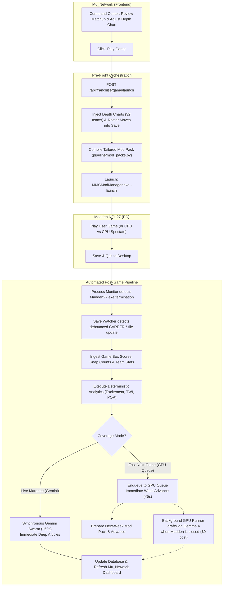

# Project Mu: V2 Master Plan — The Autonomous Gridiron Universe

**Status (2026-10-29):** Approved architecture. Split from [`PC_MIGRATION_PLAN.md`](./PC_MIGRATION_PLAN.md) to serve as the master specification for all post-migration features, universe agency, front-office control, and the headless Madden architecture.
**Prerequisite:** The PC environment, save reader/writer, and Docker Postgres are operational ([`PC_MIGRATION_PLAN.md`](./PC_MIGRATION_PLAN.md) §3, §5).
**Strategic Decision (JR, 2026-10-29):** The live **2034 canonical franchise run is held until V2 systems are fleshed out and tested** on scratch/sample saves (`CAREER-WEEK1/2/3` and `CAREER-GIANTS-AUTOSAVE`). Testing V2 first ensures that when the permanent 2034 league begins, progression, coach-set depth charts, and CBA contract mechanics are fully autonomous and controlled by Project Mu rather than Madden's native CPU algorithms.

---

## 1. Executive Summary: Headless Madden & Project Mu as the NFL OS

In the PS5 era (v1), Project Mu was an observational chronicler: Madden ran the simulation and made all front-office decisions, while Project Mu passively parsed screens via OCR to tell stories.

In **V2**, the relationship is completely inverted:
* **Project Mu is the Operating System of the NFL Universe:** It owns all league state, player development, deterministic analytics, trades, contract negotiations, free agency, the college draft, weekly game planning, and depth charts across all 32 teams.
* **Madden 27 is a Headless 60-Minute Physics Engine:** Madden is never used for menus, franchise management, or CPU transactions. Its sole function is to load a pre-configured save, simulate or play the 60 minutes of on-field football physics, write the resulting stats to disk, and exit.

| Dimension | Legacy PS5 Setup (v1) | V2 Architecture |
| :--- | :--- | :--- |
| **Primary System Authority** | Madden Franchise Engine | **Project Mu Platform** |
| **Front Office & Roster Moves** | Madden CPU / Manual controller clicks | **Project Mu Autonomous GM Agents & Engines** |
| **Depth Charts** | Madden auto-sorting | **Project Mu Coach AI (32 Teams) + User Command Center** |
| **Player Development** | Madden XP sliders | **Deterministic Mu Progression Engine** ([`engines/progression.py`](../../engines/progression.py)) |
| **Contract Rules & Economics** | Madden arcade contracts | **Strict Real-Life NFL CBA Mechanics** (Tags, 5th-Year Options, Dead Money) |
| **Free Agency** | One-click instant accept | **Multi-Dimensional Agent Negotiation & Utility Scoring** |
| **Game Day Experience** | Navigating Madden menus | **One-click "Play Game" from `Mu_Network` Command Center** |

---

## 2. The Franchise Command Center (`Mu_Network`)

Rather than relying on Madden's franchise screens, the React 19 + Vite frontend (`Mu_Network`) features a dedicated, comprehensive **Franchise Command Center** (e.g. `/franchise`). This serves as the user's personal war room as Head Coach and General Manager.

```
┌─────────────────────────────────────────────────────────────────────────────────┐
│                          FRANCHISE COMMAND CENTER                               │
│  [Game Center]  [Depth Chart]  [Roster & Cap]  [Free Agency]  [Contract Room]   │
│                 [Trade Machine]  [Draft & Scouting]  [Training Room]            │
└─────────────────────────────────────────────────────────────────────────────────┘
```

### 2.1 Module 1: Game Center (Weekly Opponent Prep & One-Click Launch)
* **Opponent Scouting Dossier:** Record, offensive/defensive rankings (EPA, pass/rush splits), personnel groupings, weather conditions, and the newsroom’s matchup primer.
* **Matchup Breakdown:** Head-to-head positional battles (e.g. your Pass Rush vs their LT, your Slot WR vs their Nickel CB).
* **Game Strategy & Focus:** Set weekly offensive/defensive focuses (e.g. Blitz-heavy vs Cover-3; Inside Zone vs Deep Shot; stamina/fatigue management).
* **Post-Game Media Coverage Preference:** Toggle between:
  - **Live Marquee Mode (Gemini 3.8 Flash):** Generate comprehensive newsroom coverage immediately upon game completion.
  - **Fast Play / Deferred GPU Queue (Gemma 4):** Advance immediately to the next week (<5s); enqueue unread routine week coverage to the nightly GPU queue for $0 background drafting.
* **The "Play Game" Trigger:**
  1. Pre-flight check: validates and writes pending depth charts, roster moves, and injuries to the save.
  2. Compiles and activates the game's tailored mod pack via [`pipeline.mod_packs`](../../pipeline/mod_packs.py) (CBS/FOX/Primetime presentation and scorebugs, crowd density tier, mudded or BCA pink ball).
  3. Triggers `MMCModManager.exe -launch <pack>`.

### 2.2 Module 2: Depth Chart & Situational Roles
* **Visual Interactive Grid for All 35 Positions:**
  - **Base Offense/Defense:** QB, HB, FB, WR (WR1, WR2, WR3), TE, LT, LG, C, RG, RT, LE, RE, DT, LOLB (SAM), MLB (MIKE), ROLB (WILL), CB, FS, SS.
  - **Situational / Specialists:** 3rd Down RB (3DRB), Slot WR (3DWR), Slot CB, Sub LB, Rush LE, Rush RE, Rush DT, Kick/Punt Returners, Long Snapper.
* **Drag-and-Drop / Click-to-Swap:** Real-time visual re-ordering.
* **Coach AI Auto-Sort:** "Let Staff Set" button runs deterministic coaching logic based on scheme fit, stamina, and coach philosophy (from [`PERSONALITY_PLAN.md`](./PERSONALITY_PLAN.md)).
* **Direct Save Sync:** Writes directly to `Team.DepthChart` (each of the 35 positions points to a 6-slot `Player[]` record in the save).

### 2.3 Module 3: Roster Construction & Cap Sheet
* **Roster Sections:** Active 53/65 Roster, Practice Squad (12–16 slots), and Injured Reserve (IR).
* **Financial Cap Sheet (Live & 5-Year Outlook):** Real-time breakdown of Total Cap, Cap Room, Salaries, Dead Money, and Rookie Reserve ([`server/front_office_api.py`](../../server/front_office_api.py)).
* **Roster Moves with Financial Safety Warnings:**
  - **Cut Player:** Displays exact **Cap Savings** vs **Dead Money Penalty** before confirmation. Warns if dead money acceleration results in negative cap savings.
  - **Practice Squad:** Promote to active roster or demote to practice squad (with eligibility validation).
  - **Injured Reserve:** Place eligible injured players on IR to open active roster spots.

### 2.4 Module 4: Free Agency & Waivers
* **Searchable Market Browser:** Filter all unassigned players across the league by position, OVR, age, scheme fit, and dev trait.
* **Interactive Negotiations:** Not a one-click transaction. Free agents negotiate based on financial offers, depth chart opportunity, and team competitiveness (see §3 below).
* **Waiver Wire:** Weekly waiver claims processed in inverse standings order before players clear to unrestricted free agency.

### 2.5 Module 5: Contract Room (In-Season Extensions & Cap Management)
* **Expiring Contracts Watchlist:** Highlights players in their contract year eligible for extension under NFL CBA rules.
* **Interactive Agent Negotiation:** Propose years, total money, and signing bonus. Player agents evaluate offers in real time and return acceptances, rejections, or counter-demands.
* **Restructure Tool:** Convert non-guaranteed base salary into signing bonus to create immediate cap space, showing the exact future dead money risk.

### 2.6 Module 6: Trade Machine & Trade Block
* **Two-Way Trade Machine:** Add players and future draft picks (next 3 drafts) from both sides.
* **Real-Time Surplus Value Bar:** Powered by [`engines/trade_value.py`](../../engines/trade_value.py), evaluating player surplus value ($V_T$) and pick curves.
* **Cap Verification:** Confirms both teams can legally absorb the incoming contracts and charges dead money to the trading team.
* **AI GM Dialogue:** AI GMs review proposals using personality traits, team direction (Contend / Retool / Rebuild), and positional needs ([`engines/gm_negotiation.py`](../../engines/gm_negotiation.py)).
* **Trade Block:** Place user players on the block and view CPU trade targets and rumors.

### 2.7 Module 7: College Scouting & Draft War Room
* **Consensus & Team Scouting Boards:** Track scouted prospects, archetype grades, combine metrics, and scout notes ([`engines/scouting_boards.py`](../../engines/scouting_boards.py), [`server/draft_api.py`](../../server/draft_api.py)).
* **Draft Capital Ledger:** Track all owned picks across 7 rounds for the next 3 draft classes.
* **Live War Room (Offseason):** Interactive draft board to make user picks while AI GMs execute deterministic picks based on their team boards.

### 2.8 Module 8: Training Room & Medical
* **Detailed Medical Ledger:** Track injury types, recovery timelines (weeks remaining), and game status (Out, Doubtful, Questionable).
* **Return-to-Play Management:** Clear healed players or manage snap counts.

---

## 3. Real-World NFL CBA Contract & Economic Mechanics

Project Mu abandons simplistic video-game contract models in favor of canonical NFL Collective Bargaining Agreement (CBA) rules:

### 3.1 Strict Extension Windows (Eligibility)

| Player Category | Real-Life NFL CBA Rule | Project Mu Rule |
| :--- | :--- | :--- |
| **Drafted Rookies** | Cannot renegotiate or extend until after the regular season of their **3rd NFL season** (CBA Article 7, Section 3(k)). | Extensions blocked until the offseason entering Year 4. 5th-year option decision occurs after Year 3. |
| **Undrafted Rookies** | Cannot renegotiate or extend until after their **2nd NFL season**. | Extensions blocked until after Year 2 regular season. |
| **Veterans (Multi-Year Deals)** | Cannot renegotiate until at least **12 months** have passed since signing or last restructure, OR when entering their **final contract year**. | Extensions allowed only in the final year of the deal or once 12 months have elapsed. |
| **Players on 1-Year Contracts** | Cannot be extended mid-season until the final week of the regular season / offseason. | Re-signing negotiations unlock in Week 18. |
| **Tagged Players** | Multi-year extension window closes in mid-July; otherwise locked into the 1-year tag tender. | If no deal is reached before training camp, player plays on tag for that season. |

### 3.2 Contract Types & Instruments

1. **Standard Multi-Year Deal:**
   - **Length:** 1 to 5 years (matching save capabilities).
   - **Base Salary ($P$):** Paid weekly across the 18-week season.
   - **Signing Bonus ($B$):** Cash paid upfront, prorated evenly against the cap over the lesser of contract length or **5 years**.
   - **Incentives:** Likely to Be Earned (LTBE, counts on current cap) vs Not Likely to Be Earned (NLTBE, counts against next year's cap if achieved).
2. **5th-Year Option (1st Round Picks Only):**
   - Exercised between end of Year 3 and May 2nd of the 4th offseason. 100% fully guaranteed.
   - **Salary Tiers:**
     - *Tier 1 (Multiple Pro Bowls):* Franchise Tag value at the position.
     - *Tier 2 (1 Pro Bowl):* Transition Tag value.
     - *Tier 3 (Playtime criteria: 75%+ snaps in 2 of 3 years):* Average of 3rd–20th highest salaries.
     - *Tier 4 (Basic):* Average of 3rd–25th highest salaries.
3. **Franchise & Transition Tags:**
   - Applied in the late February / early March window.
   - *Exclusive Franchise Tag:* Top 5 average salary in current year, or 120% of previous salary. Player cannot negotiate with other clubs.
   - *Non-Exclusive Franchise Tag:* Top 5 average over past 5 years as % of cap, or 120% of prior salary. Other teams can sign to an offer sheet; original team gets two 1st-round picks if they decline to match.
   - *Transition Tag:* Top 10 average salary; right of first refusal, no draft pick compensation.
4. **RFA & ERFA Tenders:**
   - *Exclusive Rights (ERFA, $\le 2$ accrued seasons):* 1-year league minimum tender; player must sign or sit out.
   - *Restricted Free Agent (RFA, 3 accrued seasons):* 1st-round, 2nd-round, or Right-of-First-Refusal tenders.
5. **Restructure Mechanics:**
   - Converts up to 90% of base salary into signing bonus, spreading the cap charge into future years to create immediate cap space, while increasing future dead money liability.

### 3.3 Cap Mathematics & Dead Money Acceleration

Madden saves store money in units of **$10,000** (e.g. $15,000,000 = `1500`). The cap ledger strictly enforces:

$$\text{Cap Hit}_t = \text{Base Salary}_t + \text{Prorated Signing Bonus}_t + \text{LTBE Incentives}_t$$

$$\text{Dead Money (Pre-June 1)} = \sum_{k=t}^{\text{end}} \text{Prorated Signing Bonus}_k + \text{Guaranteed Base Salary}_t$$

$$\text{Cut Savings}_t = \text{Cap Hit}_t - \text{Dead Money}_t$$

If $\text{Cut Savings} < 0$, cutting or trading the player reduces available cap space immediately.

---

## 4. Free Agency Negotiation Engine

Free agency is **never a one-click sign**. Both in-season free agents and offseason free agents evaluate offers through a multi-dimensional utility function:

$$\text{Offer Score } (U) = w_{\text{money}} \cdot S_{\text{financial}} + w_{\text{role}} \cdot S_{\text{opportunity}} + w_{\text{team}} \cdot S_{\text{contention}} + w_{\text{scheme}} \cdot S_{\text{scheme}} + \epsilon_{\text{persona}}$$

### 4.1 Evaluation Dimensions

1. **Financial Value ($S_{\text{financial}}$):**
   - Evaluated against market worth $W(\text{ovr}, \text{group})$ from [`engines/trade_value.py`](../../engines/trade_value.py).
   - **Guaranteed Money Ratio:** Share of total contract value guaranteed. Veterans heavily penalize non-guaranteed backloaded deals.
   - **Term Fit:** Aging veterans (30+) demand multi-year security; prime players (24–27) prefer shorter deals to test free agency again.
2. **Role & Depth Chart Opportunity ($S_{\text{opportunity}}$):**
   - The engine checks where the player would sit on the acquiring team's depth chart:
     - Clear Starter ($u = 1.0$) $\rightarrow$ Full score.
     - Situational / 3rd Down Specialist ($u = 0.65$) $\rightarrow$ Minor penalty.
     - Deep Bench / Backup ($u = 0.3$) $\rightarrow$ Severe penalty.
   - *Rule:* A starting-caliber player (e.g. 80+ OVR) will reject an offer to be a backup unless paid a massive financial premium.
3. **Team Contention & Prestige ($S_{\text{contention}}$):**
   - Based on team win percentage, playoff odds, and franchise popularity (`team_seasons.popularity_index`).
   - Contenders receive a "contender discount"; struggling franchises must pay a "rebuilder tax".
4. **Player Persona Traits ($\epsilon_{\text{persona}}$):**
   - Integrated with [`newsroom/config/persona_traits.json`](../../newsroom/config/persona_traits.json) and [`PERSONALITY_PLAN.md`](./PERSONALITY_PLAN.md):
     - **`Ring Chaser`:** $w_{\text{team}}$ tripled; gladly accepts below-market 1-year deals on top contenders.
     - **`Bag Chaser / Mercenary`:** $w_{\text{money}}$ dominates completely; guarantees are prioritized above all else.
     - **`Scheme Purist`:** Requires high scheme fit ($\ge 85\%$).
     - **`Ego / Prideful`:** Rejects backup designations regardless of financial compensation.

### 4.2 In-Season Free Agents vs. Offseason Waves
* **In-Season "Street" Free Agents:** The bar to accept is lower (players want to play and stay in the league), but they still evaluate respect, minimum financial floors, and role expectations.
* **Offseason Bidding Waves:** CPU teams actively evaluate needs and place competing bids across Wave 1 (superstars), Wave 2 (quality starters), and Wave 3 (depth), creating genuine bidding wars.

---

## 5. The Automated Game Lifecycle Orchestrator



1. **User Action:** You finalize depth charts and game strategy in `Mu_Network`, then click **Play Game**.
2. **Pre-Flight Save Injection:** The backend writes all 32 team depth charts, contracts, and roster moves directly to the save file.
3. **Mod Pack Activation & Launch:** [`pipeline.mod_packs`](../../pipeline/mod_packs.py) configures the active broadcast presentation (CBS/FOX/TNF/SNF/MNF), crowd tier, and ball type, then executes `MMCModManager.exe -launch <pack>`.
4. **Gameplay:** You play the game in Madden. On completion, simply save and exit the game to desktop.
5. **Autonomous Ingestion & Dual-Track Media Dispatch:**
   - The process monitor ([`pipeline/gpu_queue/process_check.py`](../../pipeline/gpu_queue/process_check.py)) detects `Madden27.exe` has closed.
   - [`pipeline/watch_save.py`](../../pipeline/watch_save.py) ingests the save, executes deterministic engines, updates standings, and checks the configured coverage mode:
     - **Live Marquee Mode (Gemini 3.8 Flash):** Executes [`weekly_capture.step_articles()`](../../pipeline/weekly_capture.py) synchronously, delivering full-depth analytical journalism ready for immediate reading.
     - **Fast Next-Game Mode (Deferred GPU Queue / Gemma 4):** Bypasses synchronous article generation. The watcher enqueues an `ARTICLE_SLATE` job into [`pipeline.gpu_queue`](../../pipeline/gpu_queue/queue.py), prepares the next game's mod pack, and advances the week in **under 5 seconds**, letting you boot straight into the next game. The RTX 5070 Ti drafts the unread articles in the background via `ollama:gemma4:e4b@nothink` at $0 cost once Madden exits or while idle.

### 5.1 Dual-Track Media Architecture (Live Marquee vs. Deferred Universe Background)

When playing multiple franchise games or simming through regular season stretches, generating 18 multi-turn research articles synchronously (60–90 seconds) creates unwanted gameplay friction. Conversely, skipping articles entirely damages long-term universe continuity (breaking reporter memories, historical references, and website archives).

The Dual-Track pipeline resolves this tension:

| Dimension | Live Marquee Mode | Deferred GPU Queue Mode |
| :--- | :--- | :--- |
| **Model** | `gemini-3.8-flash:low` (Cloud API) | `ollama:gemma4:e4b@nothink` (Local RTX 5070 Ti) |
| **Execution Trigger** | Synchronous on save ingest (or manual "Generate Now" click) | Background job runner when `Madden27.exe` is closed |
| **Best Used For** | Super Bowl, playoff weeks, rivalry games, season openers, feature reads | Routine regular-season weeks, back-to-back gameplay sessions, fast simming |
| **Post-Game Delay** | ~60–90 seconds (full database research tools) | **< 5 seconds** (stats and week advance only) |
| **Cost** | ~$0.13 per weekly slate | **$0.00** |
| **Universe Effect** | Full literary depth, nuanced tactical critique | 100% universe continuity, valid memory takes, populated news feeds |

### 5.2 Cloud GPU Studio & Monthly Compute Budget (Google Colab Stretch Goal)

For heavy batch multimedia workloads that exceed the RTX 5070 Ti's 16GB VRAM or require long rendering times that could interrupt active gaming, Project Mu leverages monthly cloud GPU credits (e.g. Google One AI Premium Colab allocation: ~100 compute units / month on T4, L4, V100, and A100 GPUs).

#### Monthly Heuristic Baseline (Maximum 2 Seasons / Month)
A realistic upper bound on gameplay velocity is **at most 2 full franchise seasons completed per calendar month** (~40–48 game weeks total, 2 NFL Draft cycles):

| Workload | Model & Target GPU | Compute Duration per Run | Monthly Frequency (2 Seasons/Mo) | Estimated Monthly Compute Units |
| :--- | :--- | :--- | :--- | :--- |
| **Weekly Multi-Speaker Broadcast Podcasts (§V2.6)** | F5-TTS / CosyVoice 2 / ChatTTS on **T4 or L4** | ~3–4 min per 10–15 min episode | 40–48 weekly episodes | **~4.5–5.0 units** (T4) or **~18–20 units** (L4) |
| **Cinematic Round 1 Draft Walkout Videos (§V2.17)** | LTX-Video / Wan2.1-I2V on **A100 (40GB/80GB)** | ~25s (LTX) to ~70s (Wan2.1) per 5s video | 64 total videos (32 picks × 2 drafts) | **~4.5–5.0 units** (LTX) or **~12–15 units** (Wan2.1) |
| **Seasonal Rookie & League Headshots** | RealVisXL_V5.0 on **Local RTX 5070 Ti** | ~6s/player (~28 min total/class) | 2 rookie classes | **0 units ($0.00)** — runs entirely on local GPU |

#### Monthly Headroom & Feature Expansion Runway
* **Total Peak Monthly Spend:** **~10 to 25 compute units** across all podcasts and draft video renders combined.
* **Guaranteed Surplus:** **75 to 90 compute units remain untouched every month** out of the 100-unit monthly quota.
* **How Surplus Credits Are Allocated:**
  1. **Writer Persona & GM Style Fine-Tuning:** Running Unsloth/PEFT LoRA training on Qwen 2.5 or Llama 3 models using authentic Project Mu journalistic corpora (~1–2 hours on an A100 = ~10–15 units once or twice a year).
  2. **High-Tier Model Quality Evaluation:** Running the 7-task benchmark matrix ([`tools/llm_compare.py`](../../tools/llm_compare.py)) against candidate 27B–70B open models or large MoEs in vLLM without VRAM offload penalties (~2–3 units per run).
  3. **Generative UI & Visual Journalism:** Experimenting with event photojournalism and championship banner generation.

---

## 6. The V2 Feature Suite (Detailed Catalog)

### V2.0 Ground Rules
* **Numbers Stay Deterministic:** Engines decide values, ratings, deals, draft boards, and outcomes. Language models write dialogue, rationale, and choose among engine-permitted options.
* **Strict Hallucination Policy:** Narrative color is encouraged, but factual contradictions (stats, scores, names, contracts) are strictly banned.
* **Resource Separation:** Batch jobs run on the nightly GPU queue ([`pipeline/gpu_queue/`](../../pipeline/gpu_queue/)); interactive tasks use ultra-compact models or cloud fallback.
* **Quality Gate:** Every feature must pass side-by-side evaluation ([`tools/llm_compare.py`](../../tools/llm_compare.py)) before deployment.

### V2.1 Project Mu News Inside Madden
Inject top Project Mu headlines directly into Madden's `NewsCenterArticle` and `NewsCenterArticleData` save tables, displaying the universe's headlines inside Madden's in-game menus.

### V2.2 Interactive Press Conferences
Postgame press conferences where newsroom personas question JR based on real box-score events, scoring swings, and player usage. JR's answers become quotes in weekly articles and update reporter memories ([`newsroom/agent_memory.py`](../../newsroom/agent_memory.py)).

### V2.3 Authentic Player Voices
* Postgame quotes generated for all 16 weekly games from real box-score stat lines.
* Player accounts on Agent Wire expressing celebration, frustration, contract-year focus, or injury updates in distinct voices.

### V2.4 Photography with Consistent Faces
Use local image generation with IP-Adapter / face-ID adapters to generate photojournalism featuring consistent player faces across draft night, award ceremonies, press conferences, and feature articles.

### V2.5 Fan Ecosystem & Team Sentiment
Agent fans reacting to game outcomes, generating article comments, team forum threads, and driving a dynamic team sentiment index that impacts coach hot seats and ticket demand.

### V2.6 Radio Shows & Podcasts (Multi-Voice Neural TTS & Cloud GPU Studio)
Automated weekly audio recaps, pregame primers, and roundtable sports talk shows published to `Mu_Network`. Powered by modern open zero-shot neural TTS models (e.g. F5-TTS, CosyVoice 2, or ChatTTS) using reference audio anchors to produce distinct, expressive, human-sounding voices across contrasting archetypes:
* **The Play-by-Play Host:** Fast-paced, measured, broadcast cadence.
* **The Film Room Analyst (Barnwell-style):** Analytical, deliberate, citing EPA and coverage schemes.
* **The Reactionary Pundit:** Loud, energetic hot takes with natural vocal interruptions.
* **The Local Beat Reporter:** Direct from locker rooms with insider updates and injury notes.
Can be rendered locally on the nightly GPU queue or offloaded in ~3–4 minutes to the Cloud GPU Studio (Colab T4/L4) for ~0.1 compute units per episode (§5.2).

### V2.7 Complete League Game Recaps
Detailed narrative recaps for all 16 games every week generated from native box scores and scoring summaries.

### V2.8 League Memory (Built)
PostgreSQL-backed narrative search index ([`newsroom/league_memory.py`](../../newsroom/league_memory.py)) enabling journalists and agents to pull authentic historical callbacks ("last time Carolina won 5 straight was 2031").

### V2.9 Front-Office Inbox & Direct Conversations
Interactive messaging system allowing JR to communicate with team owners, player agents, rival GMs, beat reporters, and college prospects.

### V2.10 Scouting Revamp & Combine Interviews
Comprehensive narrative reports for every draft prospect, individual scout voices with regional biases, and interactive combine/visit interviews.

### V2.11 Live Multi-Turn Trade Negotiations
Interactive negotiation loops with AI GMs featuring counter-offers, trade posturing, leaks to media insiders, and published negotiation transcripts for CPU-to-CPU deals.

### V2.12 Long-Term Team and League Narratives
Persistent narrative arc tracker following season-long storylines (rookie QB development, dynasty defense decline, coach hot seats, contract holdouts).

### V2.13 Personalities Across the NFL Universe (Built, Phases 1–3)
50-trait validated personality system ([`newsroom/config/persona_traits.json`](../../newsroom/config/persona_traits.json)) extending numeric behavioral sliders to players, coaches, GMs, and scouts.

### V2.14 Project Mu Owns Progression & Overall Rating (OVR) Mechanics
Madden XP progression sliders are set to 0. All player attribute development, stagnation, and age regression are calculated deterministically by [`engines/progression.py`](../../engines/progression.py) and written straight to the save file.

#### In-Game OVR Calculation vs. Static Save Records (Empirical Findings, 2026-10-30)
In-game testing on Madden 27 PC (`CAREER-2026SB-MODIFIED-AUTOSAVE` with Bryce Young) resolved the critical question of how Madden determines player overall ratings when individual attributes are modified:
1. **Dynamic Runtime UI & Gameplay Recalculation:** Madden's runtime simulation and UI do *not* rely purely on static table integers. When individual ratings (e.g. Throw Power, Accuracy, Speed, Acceleration) were modified in the save while leaving the stored `Player.OverallRating` field at `82`, loading the save into Madden immediately recalculated and displayed Bryce Young at a morale-adjusted **93 OVR** in the depth chart and player card. Madden continuously calculates effective OVR dynamically from the 54 raw ratings, scheme fit, and morale.
2. **Formula Fidelity (`engines/ovr_weights.py`):** Project Mu's reverse-engineered formula—fitted with quadratic terms across 9,106 archetype grades—predicted an exact base overall of **94 OVR** (`QB_FieldGeneral`: 94, `QB_StrongArm`: 93, `QB_Improviser`: 90, `QB_Scrambler`: 89) for those exact modified ratings, aligning within $\pm 1$ of Madden's internal calculation.
3. **Mandatory Dual-Write Rule:** Despite runtime recalculation in the game engine, `save_writer.mjs` and [`engines/progression.py`](../../engines/progression.py) must strictly execute a **dual-write** (using `--write-ovr`):
   - Always write individual ratings *and* explicitly compute and write `Player.OverallRating`, `OverallGrade0-4`, and `PlayerType`.
   - *Rationale:* Madden's save parser does not rewrite the binary database table on disk upon load. External snapshot tools (`load_save.py`), web API queries, and Madden's background CPU logic (such as trade evaluation algorithms and cut decisions) evaluate the static database column directly. Writing both guarantees 100% parity between database state, raw save inspection, and in-game UI.

### V2.15 Project Mu Runs the League (Headless League Office)
Full front-office automation for all 32 teams across trades, signings, cuts, draft picks, and coach hirings, executing moves via the save writer ([`LEAGUE_OFFICE_PLAN.md`](../not_started/LEAGUE_OFFICE_PLAN.md)).

### V2.16 Dual-Track Media Engine (Marquee Live vs. Background Universe Queue)
Configurable post-game journalism pipeline (§5.1): major matchups, playoffs, and manual requests run synchronous Gemini 3.8 Flash slates for deep reading; fast gameplay sessions advance in <5s and enqueue articles to the RTX 5070 Ti GPU queue for free background drafting with Gemma 4, keeping universe history complete without gameplay interruption.

### V2.17 Cinematic Round 1 Draft Walkout Videos (Stretch Goal)
Automated generation of 31–32 five-second broadcast video clips for Round 1 NFL Draft picks, showing each drafted prospect walking onto the draft stage, shaking the NFL Commissioner's hand, and donning the drafting team's official cap.
* **Architecture:** 2-step Image-to-Video generation pipeline executed via the Cloud GPU Studio (§5.2):
  1. *Staging Composite:* Composites the drafted rookie's synthesized media-day portrait (`static/players/{player_id}.webp`, from `headshots/`) onto a high-resolution draft-stage body plate in a tailored suit holding or wearing the drafting franchise's team cap and jersey.
  2. *I2V Diffusion Animation:* Passes the staged portrait into an open Image-to-Video DiT model (LTX-Video on A100 at ~25s/clip, or Wan2.1-I2V / CogVideoX-5B at ~60–75s/clip) with cinematic broadcast camera tracking and flashbulb lighting prompts.
* **Delivery & Interface:** Exports 5-second 720p/1080p MP4s to `static/draft/videos/{season}_pick_{pick_no}.mp4`. In `Mu_Network`'s Draft Central War Room, clicking on any Round 1 pick seamlessly plays their official stage entrance video inline.
* **Compute Cost:** ~4.5–5 compute units on Colab A100 once per draft (~9–10 units/year for 2 drafts).

---

## 7. Implementation & Testing Roadmap

All development and testing will occur on the PC using existing scratch saves (`CAREER-WEEK3` on `pc-wsl`):

```
┌─────────────────────────────────────────────────────────────────────────────────┐
│ Phase 1: Save Writer Primitives (depth_chart.mjs, sign.mjs, trade.mjs)          │
│                                      │                                          │
│                                      ▼                                          │
│ Phase 2: Engine & CBA Logic (engines/contracts_engine.py, free_agency_engine.py)│
│                                      │                                          │
│                                      ▼                                          │
│ Phase 3: Backend API Endpoints (server/franchise_api.py)                        │
│                                      │                                          │
│                                      ▼                                          │
│ Phase 4: Lifecycle Automation (pipeline/watch_save.py game monitor)             │
│                                      │                                          │
│                                      ▼                                          │
│ Phase 5: Frontend Franchise Command Center (Mu_Network React UI)                │
└─────────────────────────────────────────────────────────────────────────────────┘
```

1. **Phase 1: Save Writer Primitives (`pipeline/save_reader/`):**
   - Build `depth_chart.mjs` (read/write 35 position depth charts, 6 slots each).
   - Build `sign.mjs` and `trade.mjs` (completing roster moves alongside `release.mjs`).
   - Verify on `CAREER-WEEK3` with full read-back integrity.
2. **Phase 2: Economic & CBA Engines:**
   - Implement `engines/contracts_engine.py` (extension eligibility, 5th-year option tiers, franchise tags, dead money math).
   - Implement `engines/free_agency_engine.py` (multi-dimensional player offer evaluation utility).
3. **Phase 3: Backend Franchise API (`server/franchise_api.py`):**
   - Endpoints for depth chart management, roster cuts/promotions, free agency offers, contract negotiations, trade evaluations, and the game launch trigger.
4. **Phase 4: Game Lifecycle Automation:**
   - Enhance [`pipeline/watch_save.py`](../../pipeline/watch_save.py) and [`pipeline/gpu_queue/process_check.py`](../../pipeline/gpu_queue/process_check.py) to automatically ingest upon `Madden27.exe` process termination.
5. **Phase 5: Frontend Franchise Command Center:**
   - Build the complete `/franchise` dashboard in `Mu_Network`, integrating all 8 modules.
