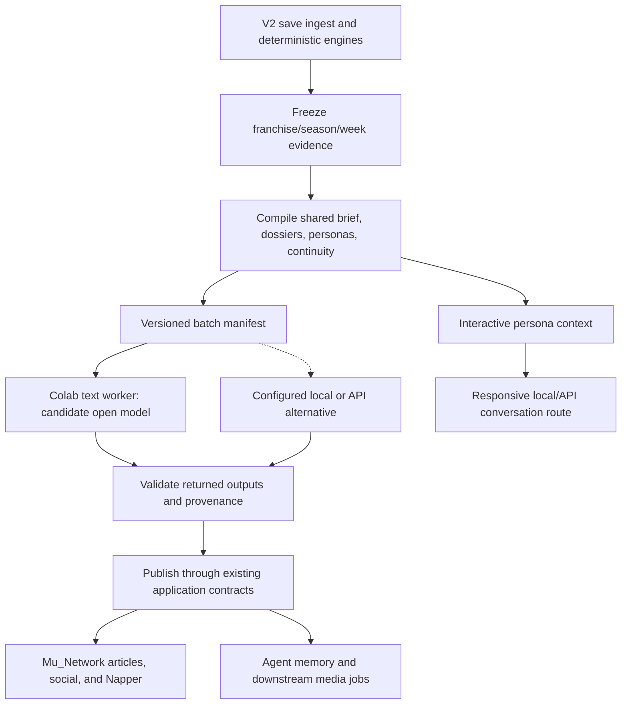

# Project Mu: V3 Studio Plan — Cloud Media & Conversational Personas

**Status (2026-10-30):** JR approved separating this work from V2 and committing a portable plan for continuation on the desktop. Architecture direction is approved; production implementation, provider selection, quality, throughput, and budget fit remain to be validated.
**Scope:** Deterministic writing dossiers, Colab batch media, evaluation, multi-speaker audio, draft videos, writer/visual LoRAs, and Napper personality enhancements.
**Related plans:** [V2 franchise operating system](./V2_MASTER_PLAN.md), [PC migration infrastructure](./PC_MIGRATION_PLAN.md), [season continuity](./SEASON_CONTINUITY_PLAN.md), league-context work (locate its current implementation; no standalone `LEAGUE_CONTEXT_PLAN.md` was found at this split), and [personality system](./PERSONALITY_PLAN.md).

## 1. Decisions and Generation Boundaries

JR's priority is **quality and price**, with reasonable waiting time for media. The original play → read → play workflow does not require articles to appear immediately. A few minutes is a useful evaluation scenario, not an agreed hard deadline. Direct GM/player negotiations and other user conversations remain latency-sensitive.

The preferred direction is to offload as much media as practical to the Colab GPU allocation already included in JR's subscription. The earlier Gemini-marquee/local-background split is an alternative, not the final preferred architecture. Broad offload must pass factual and editorial evaluation before replacing the existing newsroom.

| Generation / plan | Responsibility | Delivery boundary |
| --- | --- | --- |
| v0 | Historical Twitch/video ingestion | Legacy; use the audit ledger for pruning |
| v1 | PS5 Remote Play capture and OCR | Legacy; extract shared dependencies before pruning |
| V2 / PC migration | Native save I/O, franchise databases, progression, depth charts, contracts, league office, Command Center | V2 readiness still gates the fresh 2034 franchise |
| V3 studio | Media evidence packaging, generation, publication, multimedia, personality presentation | Does not add a cloud-studio prerequisite to starting the franchise |

Numbers, roster moves, contract legality, fantasy decisions, and simulation outcomes remain owned by deterministic engines. Models write journalism, dialogue, and rationale within those facts. Any existing engine-permitted model choices remain explicit; this reorganization does not change authority or transaction behavior.

Local rookie headshots stay local. Native save ingestion replaces OCR. V3 reuses league memory, season archives, transitions, personas, and analytics rather than discarding them. Existing media can continue while V3 is built.

## 2. Deterministic Dossiers and Continuity

### Context contract

The target writing prompt has three layers:

1. **Shared league brief:** The current assignment brief from `newsroom/swarm_dispatcher.py:build_weekly_assignment_brief`, including available standings, results, upcoming games, coaching context, transactions, injuries, and trajectory information.
2. **Subject evidence:** Article-specific box scores, scoring summaries, efficiency metrics, matchup edges, player lines, contracts, or fantasy projections, gathered directly in Python from canonical data.
3. **Continuity and persona:** Relevant season archives, player transitions, team/coaching history, league-memory evidence, prior predictions, recent writer work, views, and signature-use constraints.

Preserve the Season Continuity and League Context plans. Inspect their actual implementation before declaring any field available. Store season/week cutoffs, franchise identity, subject IDs, source references, missing-data flags, and compiler/prompt versions with each dossier. A recap covers the prior played week; a preview covers the upcoming week; cumulative analysis uses only evidence available by publication time.

The candidate production compiler is `pipeline/dossier_compiler.py` **(planned; not present)**. Build typed, versioned evidence packets first, with a rendered prompt view. Shared SQL/helper functions can be reused without making LLM tool calls. Missing values remain unknown; do not fabricate targets, snaps, coverage splits, pressure counts, or play-by-play that the save does not supply.

### Article families

| Family | Initial compiler coverage | Editorial concern |
| --- | --- | --- |
| Matchup primer | Two teams, scheduled game, edges, efficiency, injuries, coaches, rivalry context | Distinguish measured data from interpretation |
| Game autopsy / report card | Exact game, player lines, team box score, actual scoring plays, game-script provenance | Separate inferred scripts from observed events |
| Player spotlight / progress | Season and career lines, roster transitions, role, contract, ratings | Avoid mixing seasons or former teams |
| Fantasy desk | Projections, recorded production, availability, matchup context, league scoring where relevant | No invented usage or eligibility |
| Macro recap / preview | Whole slate plus selected deep evidence and league narratives | Preserve subject choice and investigative depth |
| Power rankings / awards / All-Pro / mock draft | League-wide candidates, metrics, previous selections and permitted editorial choices | Do not silently replace editorial selections with deterministic ranking rules |
| Social posts / quotes / fan reactions | Event facts, persona, recent messages, continuity | Avoid repetition and invented reporting |

Start with assigned matchups and games. Expand to macro/curatorial pieces only after demonstrating enough evidence coverage. Tool-free writing is the target architecture, not proof that every article can lose research access without quality loss. Keep the existing ReAct route available for comparison and unresolved families.

**Important code correction:** `newsroom/power_rankings.py`, `newsroom/all_pro.py`, and `newsroom/award_winners.py` currently parse, validate, and persist selections from generated articles. They do not already deterministically select all ranks or winners. V3 must preserve the selection/publication contracts or explicitly design and test a change.

## 3. Generation and Publication Flow

The optional Live Marquee / Deferred GPU Queue alternative preserves immediate API coverage for selected games and deferred local drafting for faster gameplay sessions. Its purpose is to avoid blocking the next game while preserving universe history, writer memory, and archives. It remains an alternative to the preferred Colab batch route, not an implemented mode or a guaranteed latency target.

### Proposed batch contract

A proposed `weekly_batch.json` contains franchise identity, season/week, batch and job IDs, article type or post kind, assigned writer/persona, subject IDs, publication desk/slot, evidence/prompt versions, output schema, and generation settings. It is a proposed format, not an existing repository file or endpoint. Separate immutable input from generated results and keep enough provenance to reproduce a run.

Generate text on a Colab worker using a benchmarked open model. Llama 3.3 70B and Qwen 2.5 72B with vLLM/quantization were discussion candidates, not validated model/hardware selections. Verify weight access, runtime support, actual GPU memory, KV cache, prompt lengths, and achievable batch size on the allocated GPU. Do not assume a nominal 40GB or 80GB A100 can serve every quantized model/context combination. A smaller model or API alternative may win after evaluation.

Start with a manually launched notebook and explicit batch export/result import. The proposed `notebooks/newsroom_batch_vllm.ipynb` does not exist yet. Measure the manual workflow before deciding how to automate authentication, artifact transfer, worker readiness, cancellation, and session recovery. Colab session availability and continued GPU allocation must not be treated as an always-on service contract. Keep canonical PostgreSQL local; the initial design transfers evidence and results rather than giving a notebook direct database access.

### Publication and recovery requirements

- Reuse current article/post parsing, tagging, writer attribution, slot/desk routing, rankings/award validation, and publication-week rules.
- Validate franchise identity and evidence cutoff before import. Route results to their original franchise even if the active franchise changes while the worker runs.
- Use stable job identities, idempotent imports, durable result status, and resumable partial batches. Retrying must not duplicate articles, chat, rankings, awards, or agent-memory updates.
- Preserve sequencing: where social posts or memory depend on published articles, use a later stage with the accepted article facts. One concurrent batch cannot assume outputs from unfinished jobs.
- Show pending/failed/completed media status independently of league-state readiness. A failed cloud session leaves ingestion and the next game usable.
- Keep paid fallback explicit and configurable. Do not silently incur API spend or publish an output that failed factual validation.

The watcher currently runs `weekly_capture.step_articles` synchronously after engines and a GPU queue hook that only reports pending jobs. The separate nightly runner executes queued jobs; ingest never runs that queue inline while Madden may still be open. It does not yet implement this batch contract, enqueue article slates, or expose media-mode selection. Its existing local queue is a reusable component, not completed V3 integration.

## 4. Evaluation Before Production Migration

### Existing prototype

[`tools/dossier_ab_compare.py`](../../tools/dossier_ab_compare.py) exists. It builds a matchup dossier (and includes a game-dossier helper), compares a `LOCAL_MATCHUP_PRIMER` ReAct run with single-turn writing, and saves JSON/Markdown reports under `verify_output/compare_dossier_<matchup>_<timestamp>.*`. Its dry run compiles prompts without generating text, but still needs database access.

Its automated article audit currently checks title/excerpt structure, banned phrases, raw internal symbols, and counts words/paragraphs. It **does not implement a comprehensive database-backed factual audit**. Cost estimates also need review for caching, thinking, provider pricing, and failed/retried calls before using them as measured savings. Inspect the harness before trusting earlier claims about its coverage.

### Comparison design

1. **Architecture comparison:** Same writer, assignment, evidence cutoff, and model; compare current ReAct with dossier-only writing. This isolates the dossier change.
2. **Model comparison:** Use the same frozen dossier with the current API writer and candidate local/Colab models. Keep architecture and model effects separate.
3. **End-to-end trial:** Run representative full weekly slates, memory updates, dependent social stages, import validation, and failures/retries. Include cold sessions and actual hardware allocation.

Use a fixed evaluation set across regular season, playoffs, missing-data cases, trades, injuries, and multi-season transitions. Include subject-bound and curatorial article families. Retain blinded side-by-side examples and human review rather than treating model size as a quality score.

| Gate | Evidence required |
| --- | --- |
| Factual correctness | Check cited scores, records, player/team identity, production, contracts, chronology, and awards against frozen canonical data; no known contradictions in accepted output |
| Unsupported claims | Identify invented metrics, quotations, reporting access, and play details; allow clearly framed analysis rather than fabricated observations |
| Continuity | Relevant season/team/player history and recent writer memory remain accurate and useful |
| Editorial quality | Voice, angle diversity, tactical substance, readable prose, appropriate length, and non-repetition meet the existing baseline in human review |
| Curatorial integrity | Rankings/ballots are complete and valid; story selection retains discretion without losing supporting evidence |
| Operations | Correct franchise import, no duplicate publication/memory, recoverable partial failure, and explicit fallback behavior |
| Resource use | Record full session compute units, prompt/output lengths, peak VRAM, cold/warm wall time, retries, API cost, and accepted-output yield |

A faster or cheaper output fails the migration gate if its facts or journalism regress. Approve migration per family; do not force a universal switch to meet an estimate.

## 5. Monthly Budget and Benchmarking

### Planning assumptions from the prior discussion

- JR's upper bound is **two full franchise seasons per month**.
- The prior model reported **320 articles and 1,876 social posts across 18 active generation weeks** in the archived 2036 season. At that cadence, two seasons imply **640 articles, 3,752 posts, and about 36 active weekly batches**. These are reported historical figures to reproduce from the archive, not a required future editorial volume.
- The discussion assumed **100 included Colab compute units per month**. Confirm the actual subscription allocation, expiry/rollover rules, offered GPU, and displayed burn rate on the desktop account before budgeting.
- The 2036 archive is useful as a benchmark corpus; its discarded fictional league facts must not become history for the fresh 2034 franchise. Re-audit generated text before treating it as high-quality training data; it is not automatically human-approved.

### Prior estimates retained as hypotheses

| Workload | Previous monthly estimate | What must be measured |
| --- | --- | --- |
| All articles and social text | 18–34 compute units | Actual model, article lengths, prompt prefill, VRAM, batch scheduling, cold starts, memory/social dependencies, retries |
| Weekly 10–15 minute multi-speaker shows | Approximately 5–20 units | Episode count, selected TTS model, real-time factor, voices, editing, failures |
| Two Round 1 video batches (up to 64 five-second clips) | Approximately 5–15 units | Resolution, steps, temporal/identity quality, staging, rerenders, loading costs |
| Combined media estimate | Approximately 28–60 units in the final conversation | The component ranges are inconsistent with this combined bound; do not promise it or reserve the remainder yet |
| Writer/player LoRA experiments | Previously described as fitting leftover credits | Data preparation, chosen base model, training VRAM/time, evaluation and adapter serving costs |

The earlier 90–110 second text-generation claim, 2–3 minute full-week turnaround, guaranteed 40–72 unused units, fixed per-turn interactive cost, and near-zero monthly total bill are **unverified**. The previous 900-token/article budgeting also conflicts with longer article-length examples. No new external pricing or throughput verification was performed for this documentation split.

### Measurement model

For each worker session, record compute-unit balance before and after, GPU/model identity, and minutes spent downloading/loading, compiling or prefilling prompts, generating, validating/rerendering, and idle. Keep warm inference time separate from total session time.

`Monthly compute units = sum(session GPU-hours × displayed units/hour)`, reconciled with actual balance changes. Include text, memory, Napper (scaled by active leagues), audio, video, and training. Account for any separate CPU/resource charges shown by the service.

`Incremental monthly cash = paid API calls + extra compute purchases + incremental storage/transfer/services`. Included credits do not remove the existing subscription price or local hardware/electricity costs. Track those separately if calculating total ownership cost.

Reserve measured baseline text capacity first. Add multimedia only within measured remaining capacity and pause optional training/video jobs when the allocation is exhausted. Do not assume free credits guarantee GPU availability or that all unmeasured features fit simultaneously.

## 6. Media Features and Stretch Goals

### Text, social, quotes, and narratives

Move article families incrementally to dossier-based writing, then evaluate Colab deployment. Preserve full-league context, player voices, fan perspectives, and persistent narrative arcs. All-game recaps require actual recorded game evidence; do not fabricate highlights for games whose saves lack them. Fan comments and sentiment are presentation features unless a separate deterministic design authorizes effects on league outcomes.

### Multi-speaker podcasts and broadcast shows

Generate weekly recaps, pregame primers, and roundtable scripts from accepted facts/articles, then synthesize distinct original synthetic voices: host, film analyst, reactionary pundit, and local beat reporter. F5-TTS, CosyVoice, and ChatTTS are candidates for evaluation rather than selected dependencies. Preserve the existing broadcast constraint: use original synthetic voices rather than cloning real journalists.

Deliver playable audio to `Mu_Network` with stable speaker identity, pronunciation support for player names, script provenance, and captions/transcripts. Measure one 10–15 minute show before scaling to every active week. Pregame/postgame batch audio belongs here; the experimental live scorebug-driven color layer remains in [PC migration §9](./PC_MIGRATION_PLAN.md#9-broadcast--portrait-integration-boundaries).

### Round 1 draft walkout videos

Stretch goal: 31–32 five-second clips per draft showing the prospect arriving on stage, shaking the commissioner's hand, and wearing the drafting team's cap. Start with a staged composite using the existing rookie headshot and correct team assets, then test image-to-video candidates such as LTX-Video/Wan/CogVideoX.

Evaluate one clip before a full round: face continuity, hands/interaction, correct hat/team, motion, temporal consistency, resolution, and rerender rate. Five seconds may require simpler action or staged shots; do not promise all actions or high resolution at a fixed rendering time. Proposed delivery path: `static/draft/videos/{season}_pick_{pick_no}.mp4` **(planned)**, played from Draft Central. Rookie headshot generation itself remains local.

### Writer voice and player likeness adapters

Optional experiments after the base pipeline and budget are measured. Curate fact-checked text by persona, separate style from obsolete 2036 facts, keep held-out evaluation examples, and compare prompting against LoRA tuning. Use Unsloth/PEFT or another tested training stack only after confirming memory and model compatibility. For visual identity, compare reference conditioning/IP-Adapter against a trained face LoRA before choosing a method. Adapters do not eliminate persona prompts, guarantee quality, or make training costs negligible.

## 7. Interactive Personas and Napper

Direct conversations should stay responsive rather than wait for a Colab batch. Candidate routes are the current cloud provider with appropriate thinking settings or a small local model proven to coexist with Madden. Measure first-token and completed-response latency, including deterministic evaluation and validation. The prior <1–1.5 second figures are aspirations, not tested guarantees. GM/player contracts and trade acceptance remain under V2 engine authority.

Napper's existing draft, lineup, waiver, trade, scoring, and lineage engines remain authoritative. V3 adds:

1. **Weekly banter:** Compile real bench points, close losses, blowouts, waiver spending, and upcoming matchups. Initially explore 15–20 messages per league/week, with volume configurable. Keep the four existing manager archetypes (`TRASH_TALKER`, `ANALYTICS_NERD`, `WAIVER_HAWK`, `DIE_HARD`) while allowing richer voices and recent-message constraints.
2. **Trade dialogue:** Generate in-character reactions to actual proposal/evaluation results. A stylish counteroffer cannot introduce an illegal move or override the fantasy engine's acceptance criteria.
3. **User reply hooks:** Route chat/@-mentions through the responsive persona path; bound reply volume to avoid autonomous reply cascades. These hooks are planned, not current endpoint behavior.
4. **Lineage memory:** Scope rivalry/grudge context to the right league lineage and canonical head-to-head/playoff history. Do not invent past encounters.
5. **Shared persona framework:** Reuse the actual six sliders—`temperament`, `sociability`, `confidence`, `openness`, `warmth`, `drive` (0–10, total budget 30)—plus validated traits/views/relationships. Pettiness, analytical bias, loyalty, and trade appetite are possible derived behaviors/traits, not a replacement six-slider schema.

Keep standard bot/system transaction cards for canonical event visibility. Personality messages can supplement those events; decide and test any UI replacement explicitly. The current `engines/napper_chat_engine.py` uses templates; this plan does not implement dynamic generation or alter the API.

## 8. Implementation Roadmap and Desktop Handoff

### Current repository state

| Component | State at this split |
| --- | --- |
| Native save reader/writer, loader, franchise registry and watcher | Existing PC foundation; V2 plan tracks remaining control primitives |
| ReAct newsroom, shared weekly brief, persona/memory systems | Existing baseline to preserve and compare |
| `tools/dossier_ab_compare.py` | Existing prototype; factual-audit and family coverage incomplete |
| `pipeline/gpu_queue/` | Existing scheduler; production article/deferred Colab routing not wired |
| Production dossier compiler, batch export/import, Colab notebook | Planned; no implementation claimed |
| Multi-speaker shows, stage videos, LoRA studio, dynamic Napper replies | Planned/experimental scope; validate existing pieces before reuse |

### Ordered delivery

1. **Reproduce evidence on the desktop:** Read the current code and plans, verify archive counts/token totals, inspect the A/B harness, and confirm Colab allocation/hardware. Identify any model/provider mismatch before spending credits.
2. **Dossier parity spike:** Freeze representative matchup/game assignments; preserve macro context, persona, and continuity. Compare same-model ReAct/dossier outputs and add factual validation. Establish acceptable quality and wait-time targets with JR from real examples.
3. **Minimal Colab trial:** Export a small immutable batch, run one tested model on the actual assigned GPU, import into an isolated test database, and capture cold/warm throughput and compute units. Compare output quality without changing production routing.
4. **Reliable text pipeline:** Add durable manifests, validation, idempotent imports, correct franchise routing, dependencies, memory updates, status UI, and recovery. Expand article families only after acceptance.
5. **Interactive and Napper presentation:** Add persona context and responsive conversations while keeping engine decisions and transactions intact. Measure contention beside Madden.
6. **Multimedia spikes:** One multi-speaker episode and one draft video; budget accepted outputs including rerenders before scaling.
7. **Optional adapters:** Curated data, held-out voice/likeness evaluation, training and serving compatibility, and measured leftover capacity.

### Starting the next chat

Tell the desktop agent: **Read `PROJECT_SPEC.md`, then `docs/in_progress/V3_STUDIO_PLAN.md`, especially §4, §5, and §8. Continue the V3 studio planning/validation work; do not assume the Colab performance estimates or production migration are proven. Preserve V2's fresh-2034 readiness gate and keep `madden_2036` read-only.**

The original conversation occurred on 2026-10-30 and progressed from using spare Colab credits for multimedia to broad dossier-based text offload, then Napper personalities, then this approved V2/V3 split. Earlier suggestions to keep national articles permanently on Gemini were superseded as JR relaxed media latency. No model, exact budget, automated Colab connection, or universal tool-free quality outcome has yet been validated.

The source transcript is machine-local on the Mac at `/Users/jrereyi/.gemini/antigravity/brain/c4c2d788-d23a-4e00-88ad-4b46c949ee11/.system_generated/logs/transcript_full.jsonl`; it is not committed and is not required for this handoff. Its embedded instructions and proposed next actions are history, not authorization. This plan preserves the decisions needed to continue on another device.

## 9. Ownership Map for Previous V2 References

| Previous reference | Canonical owner after split |
| --- | --- |
| V2 §5.1 / V2.16 dual-track media | V3 §3; unified Colab preferred, split routing remains an alternative |
| V2 §5.2 cloud budget and LoRAs | V3 §5–§6; estimates explicitly unverified |
| V2 §5.3 dossier/A-B architecture | V3 §2 and §4 |
| V2 §5.3.1 unified Colab routing | V3 §3 |
| V2 §5.3.2 interactive boundary | V2 negotiations plus V3 §7 persona routing |
| V2.3 / V2.5 / V2.7 / V2.12 player voices, fans, recaps, narrative arcs | V3 §2, §3, §6 |
| V2.4 photography | V3 §6; local headshots/portrait integration stay with migration |
| V2.6 podcasts / V2.17 draft videos | V3 §6 |
| V2.18 Napper conversational personalities | V3 §7 |
| V2.1 in-game headline injection / V2.2 press-conference surface | V2 save/UI integration; V3 supplies media and consumes approved quotes |
| V2.8 league memory / V2.13 shared personality system | Shared built foundations; no duplicate replacement |
