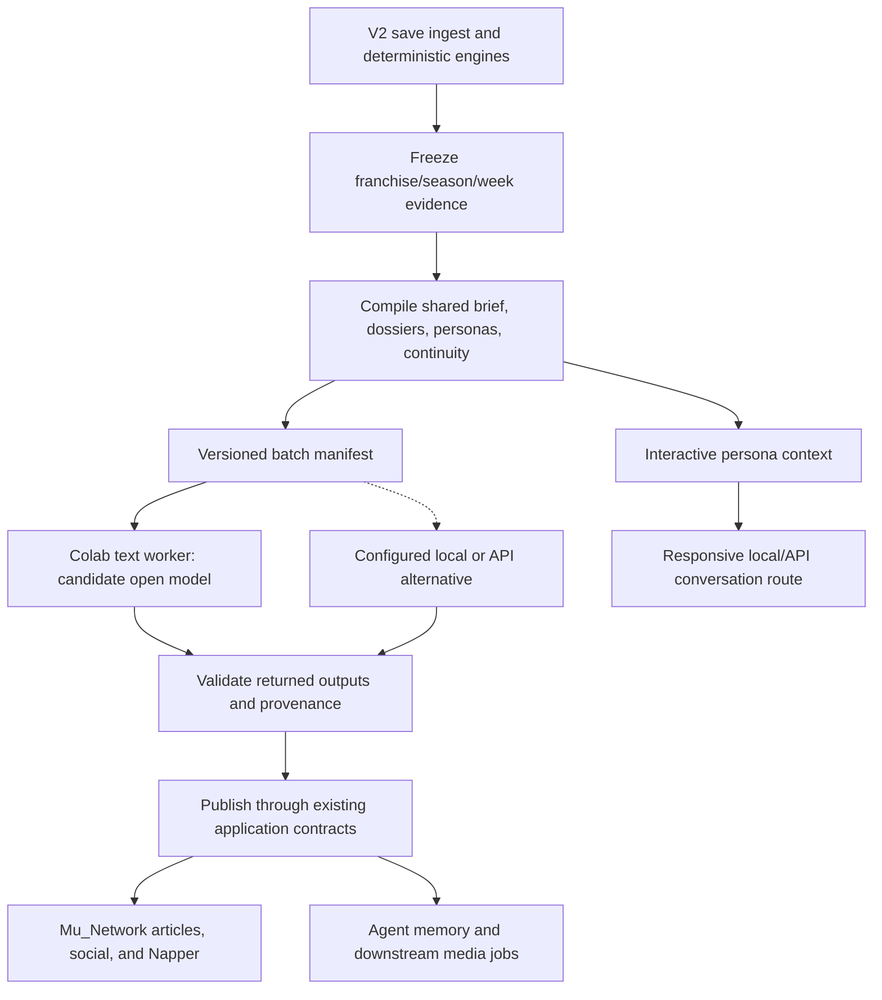

# Project Mu: V3 Studio Plan — Cloud Media & Conversational Personas

**Status (2026-10-30):** JR approved separating this work from V2 and committing a portable plan for continuation on the desktop. Architecture direction is approved; production implementation, provider selection, quality, throughput, and budget fit remain to be validated.
**Scope:** Deterministic writing dossiers, Colab batch media, evaluation, multi-speaker audio, draft videos, writer/visual LoRAs, and Napper personality enhancements.
**Related plans:** [V2 franchise operating system](./V2_MASTER_PLAN.md), [PC migration infrastructure](../done/PC_MIGRATION_PLAN.md), [season continuity](./SEASON_CONTINUITY_PLAN.md), league-context work (locate its current implementation; no standalone `LEAGUE_CONTEXT_PLAN.md` was found at this split), and [personality system](./PERSONALITY_PLAN.md).

## 1. Decisions and Generation Boundaries

JR's priority is **quality and price**, with reasonable waiting time for media. The original play → read → play workflow does not require articles to appear immediately. A few minutes is a useful evaluation scenario, not an agreed hard deadline. Direct GM/player negotiations and other user conversations remain latency-sensitive.

The preferred direction is to offload as much media as practical to the Colab GPU allocation already included in JR's subscription. The earlier Gemini-marquee/local-background split is an alternative, not the final preferred architecture. Broad offload must pass factual and editorial evaluation before replacing the existing newsroom.

| Generation / plan | Responsibility | Delivery boundary |
| --- | --- | --- |
| v0 | Historical Twitch/video ingestion | Legacy; use the audit ledger for pruning |
| v1 | PS5 Remote Play capture and OCR | Legacy; extract shared dependencies before pruning |
| V2 / PC migration | Native save I/O, franchise databases, progression, depth charts, contracts, league office, Command Center | V2 readiness gates the 2026 Madden franchise start and its all-CPU 2026–2033 era (V2 §7.2) |
| V3 studio | Media evidence packaging, generation, publication, multimedia, personality presentation | Does not add a cloud-studio prerequisite to starting the franchise |

Numbers, roster moves, contract legality, fantasy decisions, and simulation outcomes remain owned by deterministic engines. Models write journalism, dialogue, and rationale within those facts. Any existing engine-permitted model choices remain explicit; this reorganization does not change authority or transaction behavior.

Local rookie headshots stay local. Native save ingestion replaces OCR. V3 reuses league memory, season archives, transitions, personas, and analytics rather than discarding them. Existing media can continue while V3 is built.

## 2. Deterministic Dossiers and Continuity

### Context contract

The target writing prompt has three layers:

1. **Shared league brief:** The current assignment brief from `newsroom/swarm_dispatcher.py:build_weekly_assignment_brief`, including available standings, results, upcoming games, coaching context, transactions, injuries, and trajectory information.
2. **Subject evidence:** Article-specific box scores, scoring summaries, efficiency metrics, matchup edges, player lines, contracts, or fantasy projections, gathered directly in Python from canonical data.
3. **Continuity and persona:** Relevant season archives, player transitions, team/coaching history, league-memory evidence, prior predictions, recent writer work, views, and signature-use constraints.

Preserve the Season Continuity and League Context plans. Inspect their actual implementation before declaring any field available. Store season/week cutoffs, franchise identity, subject IDs, source references, missing-data flags, and compiler/prompt versions with each dossier. A recap covers the prior played week; a preview covers the upcoming week; cumulative analysis uses only evidence available by publication time.

The candidate production compiler is `pipeline/dossier_compiler.py` **(planned; not present)**. Build typed, versioned evidence packets first, with a rendered prompt view. Shared SQL/helper functions can be reused without making LLM tool calls. Missing values remain unknown; do not fabricate targets, snaps, coverage splits, pressure counts, or play-by-play that the save does not supply.

### Article families

| Family | Initial compiler coverage | Editorial concern |
| --- | --- | --- |
| Matchup primer | Two teams, scheduled game, edges, efficiency, injuries, coaches, rivalry context | Distinguish measured data from interpretation |
| Game autopsy / report card | Exact game, player lines, team box score, actual scoring plays, game-script provenance | Separate inferred scripts from observed events |
| Player spotlight / progress | Season and career lines, roster transitions, role, contract, ratings | Avoid mixing seasons or former teams |
| Fantasy desk | Projections, recorded production, availability, matchup context, league scoring where relevant | No invented usage or eligibility |
| Macro recap / preview | Whole slate plus selected deep evidence and league narratives | Preserve subject choice and investigative depth |
| Power rankings / awards / All-Pro / mock draft | League-wide candidates, metrics, previous selections and permitted editorial choices | Do not silently replace editorial selections with deterministic ranking rules |
| Social posts / quotes / fan reactions | Event facts, persona, recent messages, continuity | Avoid repetition and invented reporting |

Start with assigned matchups and games. Expand to macro/curatorial pieces only after demonstrating enough evidence coverage. Tool-free writing is the target architecture, not proof that every article can lose research access without quality loss. Keep the existing ReAct route available for comparison and unresolved families.

**Important code correction:** `newsroom/power_rankings.py`, `newsroom/all_pro.py`, and `newsroom/award_winners.py` currently parse, validate, and persist selections from generated articles. They do not already deterministically select all ranks or winners. V3 must preserve the selection/publication contracts or explicitly design and test a change.

## 3. Generation and Publication Flow



The optional Live Marquee / Deferred GPU Queue alternative preserves immediate API coverage for selected games and deferred local drafting for faster gameplay sessions. Its purpose is to avoid blocking the next game while preserving universe history, writer memory, and archives. It remains an alternative to the preferred Colab batch route, not an implemented mode or a guaranteed latency target.

### Proposed batch contract

A proposed `weekly_batch.json` contains franchise identity, season/week, batch and job IDs, article type or post kind, assigned writer/persona, subject IDs, publication desk/slot, evidence/prompt versions, output schema, and generation settings. It is a proposed format, not an existing repository file or endpoint. Separate immutable input from generated results and keep enough provenance to reproduce a run.

Generate text on a Colab worker using a benchmarked open model. Llama 3.3 70B and Qwen 2.5 72B with vLLM/quantization were discussion candidates, not validated model/hardware selections. Verify weight access, runtime support, actual GPU memory, KV cache, prompt lengths, and achievable batch size on the allocated GPU. Do not assume a nominal 40GB or 80GB A100 can serve every quantized model/context combination. A smaller model or API alternative may win after evaluation.

Start with a manually launched notebook and explicit batch export/result import. The proposed `notebooks/newsroom_batch_vllm.ipynb` does not exist yet. Measure the manual workflow before deciding how to automate authentication, artifact transfer, worker readiness, cancellation, and session recovery. Colab session availability and continued GPU allocation must not be treated as an always-on service contract. Keep canonical PostgreSQL local; the initial design transfers evidence and results rather than giving a notebook direct database access.

### Publication and recovery requirements

- Reuse current article/post parsing, tagging, writer attribution, slot/desk routing, rankings/award validation, and publication-week rules.
- Validate franchise identity and evidence cutoff before import. Route results to their original franchise even if the active franchise changes while the worker runs.
- Use stable job identities, idempotent imports, durable result status, and resumable partial batches. Retrying must not duplicate articles, chat, rankings, awards, or agent-memory updates.
- Preserve sequencing: where social posts or memory depend on published articles, use a later stage with the accepted article facts. One concurrent batch cannot assume outputs from unfinished jobs.
- Show pending/failed/completed media status independently of league-state readiness. A failed cloud session leaves ingestion and the next game usable.
- Keep paid fallback explicit and configurable. Do not silently incur API spend or publish an output that failed factual validation.

The watcher currently runs `weekly_capture.step_articles` synchronously after engines and a GPU queue hook that only reports pending jobs. The separate nightly runner executes queued jobs; ingest never runs that queue inline while Madden may still be open. It does not yet implement this batch contract, enqueue article slates, or expose media-mode selection. Its existing local queue is a reusable component, not completed V3 integration.

### Background coverage for the 2026–2033 CPU era (JR, 2026-10-30)

V2 §7.2 runs 2026–2033 as a fully CPU league before JR takes a team in 2034. League simulation does not wait on media, but JR wants those years covered so every writer has seven years of memories by 2034 and he can read 1–2 articles a season. This is the first large batch job for this plan:

* Coverage is written in week order from frozen per-week dossiers, either alongside the simulation or as a backfill afterwards; memory updates and dependent social stages follow publication order as in §3.
* No paid API spend for CPU years by default. Route to the Colab batch or the local GPU queue (§10.8), whichever passes the §4 gates first.
* Volume is the budget question: the 2036 pace (320 articles and 1,876 posts a season) over eight seasons is about 2,500 articles and 15,000 posts, roughly four months at the §5 assumption of two seasons a month. A reduced background slate for CPU years (features and memory-bearing pieces, fewer routine posts) is expected; its size is decided from measured cost.
* Prerequisite to check: the database keeps enough point-in-time state (standings, injuries, ratings, contracts, dated transactions) for a backfill dossier to see only what was known that week.

## 4. Evaluation Before Production Migration

### Existing prototype

[`tools/dossier_ab_compare.py`](../../tools/dossier_ab_compare.py) exists. It builds a matchup dossier (and includes a game-dossier helper), compares a `LOCAL_MATCHUP_PRIMER` ReAct run with single-turn writing, and saves JSON/Markdown reports under `verify_output/compare_dossier_<matchup>_<timestamp>.*`. Its dry run compiles prompts without generating text, but still needs database access.

Its automated article audit currently checks title/excerpt structure, banned phrases, raw internal symbols, and counts words/paragraphs. It **does not implement a comprehensive database-backed factual audit**. Cost estimates also need review for caching, thinking, provider pricing, and failed/retried calls before using them as measured savings. Inspect the harness before trusting earlier claims about its coverage.

### Comparison design

1. **Architecture comparison:** Same writer, assignment, evidence cutoff, and model; compare current ReAct with dossier-only writing. This isolates the dossier change.
2. **Model comparison:** Use the same frozen dossier with the current API writer and candidate local/Colab models. Keep architecture and model effects separate.
3. **End-to-end trial:** Run representative full weekly slates, memory updates, dependent social stages, import validation, and failures/retries. Include cold sessions and actual hardware allocation.

Use a fixed evaluation set across regular season, playoffs, missing-data cases, trades, injuries, and multi-season transitions. Include subject-bound and curatorial article families. Retain blinded side-by-side examples and human review rather than treating model size as a quality score.

| Gate | Evidence required |
| --- | --- |
| Factual correctness | Check cited scores, records, player/team identity, production, contracts, chronology, and awards against frozen canonical data; no known contradictions in accepted output |
| Unsupported claims | Identify invented metrics, quotations, reporting access, and play details; allow clearly framed analysis rather than fabricated observations |
| Continuity | Relevant season/team/player history and recent writer memory remain accurate and useful |
| Editorial quality | Voice, angle diversity, tactical substance, readable prose, appropriate length, and non-repetition meet the existing baseline in human review |
| Curatorial integrity | Rankings/ballots are complete and valid; story selection retains discretion without losing supporting evidence |
| Operations | Correct franchise import, no duplicate publication/memory, recoverable partial failure, and explicit fallback behavior |
| Resource use | Record full session compute units, prompt/output lengths, peak VRAM, cold/warm wall time, retries, API cost, and accepted-output yield |

A faster or cheaper output fails the migration gate if its facts or journalism regress. Approve migration per family; do not force a universal switch to meet an estimate.

## 5. Monthly Budget and Benchmarking

### Planning assumptions from the prior discussion

- JR's upper bound is **two full franchise seasons per month**.
- The prior model reported **320 articles and 1,876 social posts across 18 active generation weeks** in the archived 2036 season. At that cadence, two seasons imply **640 articles, 3,752 posts, and about 36 active weekly batches**. These are reported historical figures to reproduce from the archive, not a required future editorial volume.
- The discussion assumed **100 included Colab compute units per month**. Confirm the actual subscription allocation, expiry/rollover rules, offered GPU, and displayed burn rate on the desktop account before budgeting.
- The 2036 archive is useful as a benchmark corpus; its discarded fictional league facts must not become history for the fresh 2034 franchise. Re-audit generated text before treating it as high-quality training data; it is not automatically human-approved.

### Prior estimates retained as hypotheses

| Workload | Previous monthly estimate | What must be measured |
| --- | --- | --- |
| All articles and social text | 18–34 compute units | Actual model, article lengths, prompt prefill, VRAM, batch scheduling, cold starts, memory/social dependencies, retries |
| Weekly 10–15 minute multi-speaker shows | Approximately 5–20 units | Episode count, selected TTS model, real-time factor, voices, editing, failures |
| Two Round 1 video batches (up to 64 five-second clips) | Approximately 5–15 units | Resolution, steps, temporal/identity quality, staging, rerenders, loading costs |
| Combined media estimate | Approximately 28–60 units in the final conversation | The component ranges are inconsistent with this combined bound; do not promise it or reserve the remainder yet |
| Writer/player LoRA experiments | Previously described as fitting leftover credits | Data preparation, chosen base model, training VRAM/time, evaluation and adapter serving costs |

The earlier 90–110 second text-generation claim, 2–3 minute full-week turnaround, guaranteed 40–72 unused units, fixed per-turn interactive cost, and near-zero monthly total bill are **unverified**. The previous 900-token/article budgeting also conflicts with longer article-length examples. No new external pricing or throughput verification was performed for this documentation split.

### Measurement model

For each worker session, record compute-unit balance before and after, GPU/model identity, and minutes spent downloading/loading, compiling or prefilling prompts, generating, validating/rerendering, and idle. Keep warm inference time separate from total session time.

`Monthly compute units = sum(session GPU-hours × displayed units/hour)`, reconciled with actual balance changes. Include text, memory, Napper (scaled by active leagues), audio, video, and training. Account for any separate CPU/resource charges shown by the service.

`Incremental monthly cash = paid API calls + extra compute purchases + incremental storage/transfer/services`. Included credits do not remove the existing subscription price or local hardware/electricity costs. Track those separately if calculating total ownership cost.

Reserve measured baseline text capacity first. Add multimedia only within measured remaining capacity and pause optional training/video jobs when the allocation is exhausted. Do not assume free credits guarantee GPU availability or that all unmeasured features fit simultaneously.

## 6. Media Features and Stretch Goals

### Text, social, quotes, and narratives

Move article families incrementally to dossier-based writing, then evaluate Colab deployment. Preserve full-league context, player voices, fan perspectives, and persistent narrative arcs. All-game recaps require actual recorded game evidence; do not fabricate highlights for games whose saves lack them. Fan comments and sentiment are presentation features unless a separate deterministic design authorizes effects on league outcomes.

### Multi-speaker podcasts and broadcast shows

Generate weekly recaps, pregame primers, and roundtable scripts from accepted facts/articles, then synthesize distinct original synthetic voices: host, film analyst, reactionary pundit, and local beat reporter. F5-TTS, CosyVoice, and ChatTTS are candidates for evaluation rather than selected dependencies. Preserve the existing broadcast constraint: use original synthetic voices rather than cloning real journalists.

Deliver playable audio to `Mu_Network` with stable speaker identity, pronunciation support for player names, script provenance, and captions/transcripts. Measure one 10–15 minute show before scaling to every active week. Pregame/postgame batch audio belongs here; the experimental live color layer is below (*Live Color Layer and Game-Day Audio*).

### Round 1 draft walkout videos

Stretch goal: 31–32 five-second clips per draft showing the prospect arriving on stage, shaking the commissioner's hand, and wearing the drafting team's cap. Start with a staged composite using the existing rookie headshot and correct team assets, then test image-to-video candidates such as LTX-Video/Wan/CogVideoX.

Evaluate one clip before a full round: face continuity, hands/interaction, correct hat/team, motion, temporal consistency, resolution, and rerender rate. Five seconds may require simpler action or staged shots; do not promise all actions or high resolution at a fixed rendering time. Proposed delivery path: `static/draft/videos/{season}_pick_{pick_no}.mp4` **(planned)**, played from Draft Central. Rookie headshot generation itself remains local.

### Writer voice and player likeness adapters

Optional experiments after the base pipeline and budget are measured. Curate fact-checked text by persona, separate style from obsolete 2036 facts, keep held-out evaluation examples, and compare prompting against LoRA tuning. Use Unsloth/PEFT or another tested training stack only after confirming memory and model compatibility. For visual identity, compare reference conditioning/IP-Adapter against a trained face LoRA before choosing a method. Adapters do not eliminate persona prompts, guarantee quality, or make training costs negligible.

### Live Color Layer and Game-Day Audio (moved from PC migration §9.1–§9.3, 2026-10-30)

> Moved here from the PC migration plan on 2026-10-30. Bare section numbers (§3, §5.3, …) inside this section refer to [`PC_MIGRATION_PLAN.md`](../done/PC_MIGRATION_PLAN.md) and its [archive](../done/PC_MIGRATION_ARCHIVE.md), except where they name another plan.

Batch podcast/show production, consistent-face photojournalism, draft videos, and their cloud compute budget moved to [V3 §6](./V3_STUDIO_PLAN.md#6-media-features-and-stretch-goals). The build-order list below remains integration context; media production is a V3 deliverable. This migration plan retains the experimental live scorebug/color-layer interface and the local in-game portrait path.

Madden's commentary is pre-recorded clips triggered inside the game engine. A mod can only swap one recording for another, so Madden's live play-by-play stays. Project Mu adds a color-commentary layer on top, built from what it knows and Madden doesn't: records, rivalries, contract years, hot seats, season storylines.

#### Build Order (was PC migration §9.1)

1. **Pregame show:** a generated audio segment before kickoff from the newsroom's matchup primer (storylines, injuries, stakes, rivalry history). Needs no live game state.
2. **Halftime and postgame:** halftime from the scorebug state plus the save; postgame from the save's scoring plays (§5.3), if Madden 27 stores them.
3. **Radio-style recaps of simmed games** for `Mu_Network`, from the scoring plays. Simmed games are never played on screen, so they get recaps, not live calls.
4. **Live color layer** (§9.2), for games JR plays or watches.

#### Live Color Layer (was PC migration §9.2)

```
[Madden running, commentary volume lowered]
          │
          ▼
[Scorebug reader] (screen capture, 1–2 fps)
  score, clock, quarter, down & distance, possession, timeouts
          │
          ▼
[Event triggers]
  score change, turnover, quarter end, two-minute warning,
  conversion on 3rd/4th-and-long, red-zone stand
          │
          ▼
[Line generator] (Project Mu context: records, rivalries, storylines)
          │
          ▼
[TTS] → played between snaps, ducking Madden's commentary
```

* **Found 2026-10-30: the scorebug reader may not be needed.** Madden rewrites `INGAME-RESUMEDATA` in the saves folder after every play (seen with `tools/save_write_logger.py`), and `pipeline/ingame_resume.py` reads the score, clock, down and distance, every play (runner, receiver, yards, points) and each player's running stat line from it. Polling that file gives the triggers above with who did what, without screen capture.
* There are usually 15–30 seconds between snaps, so 2–4 seconds of generation plus speech is acceptable.
* The scorebug is one fixed layout, a much simpler read than the menu screens the PS5 capture handles today.
* No memory reading or engine hooks: those need the anti-tamper module, work offline only and break with patches.

#### Constraints (was PC migration §9.3)

* **GPU:** Madden is using the 5070 Ti during play (§7.5). Use cloud LLM and TTS for the live layer; pregame, postgame and recaps can run locally when Madden isn't running.
* **Voices:** several newsroom personas are modeled on real journalists. Broadcast voices are original synthetic voices, never clones of a real person's voice.
* **Player names:** Madden's own calls depend on each player's commentary ID. In the fresh 2034 save Madden's own players already have theirs; Mu-named draft prospects (`pipeline/teleport_draft.py`, the CFB 27 bridge) get them through `pipeline/commentary_names.py`.


## 7. Interactive Personas and Napper

Direct conversations should stay responsive rather than wait for a Colab batch. Candidate routes are the current cloud provider with appropriate thinking settings or a small local model proven to coexist with Madden. Measure first-token and completed-response latency, including deterministic evaluation and validation. The prior <1–1.5 second figures are aspirations, not tested guarantees. GM/player contracts and trade acceptance remain under V2 engine authority.

Napper's existing draft, lineup, waiver, trade, scoring, and lineage engines remain authoritative. V3 adds:

1. **Weekly banter:** Compile real bench points, close losses, blowouts, waiver spending, and upcoming matchups. Initially explore 15–20 messages per league/week, with volume configurable. Keep the four existing manager archetypes (`TRASH_TALKER`, `ANALYTICS_NERD`, `WAIVER_HAWK`, `DIE_HARD`) while allowing richer voices and recent-message constraints.
2. **Trade dialogue:** Generate in-character reactions to actual proposal/evaluation results. A stylish counteroffer cannot introduce an illegal move or override the fantasy engine's acceptance criteria.
3. **User reply hooks:** Route chat/@-mentions through the responsive persona path; bound reply volume to avoid autonomous reply cascades. These hooks are planned, not current endpoint behavior.
4. **Lineage memory:** Scope rivalry/grudge context to the right league lineage and canonical head-to-head/playoff history. Do not invent past encounters.
5. **Shared persona framework:** Reuse the actual six sliders—`temperament`, `sociability`, `confidence`, `openness`, `warmth`, `drive` (0–10, total budget 30)—plus validated traits/views/relationships. Pettiness, analytical bias, loyalty, and trade appetite are possible derived behaviors/traits, not a replacement six-slider schema.

Keep standard bot/system transaction cards for canonical event visibility. Personality messages can supplement those events; decide and test any UI replacement explicitly. The current `engines/napper_chat_engine.py` uses templates; this plan does not implement dynamic generation or alter the API.

## 8. Implementation Roadmap and Desktop Handoff

### Current repository state

| Component | State at this split |
| --- | --- |
| Native save reader/writer, loader, franchise registry and watcher | Existing PC foundation; V2 plan tracks remaining control primitives |
| ReAct newsroom, shared weekly brief, persona/memory systems | Existing baseline to preserve and compare |
| `tools/dossier_ab_compare.py` | Existing prototype; factual-audit and family coverage incomplete |
| `pipeline/gpu_queue/` | Existing scheduler; production article/deferred Colab routing not wired |
| Production dossier compiler, batch export/import, Colab notebook | Planned; no implementation claimed |
| Multi-speaker shows, stage videos, LoRA studio, dynamic Napper replies | Planned/experimental scope; validate existing pieces before reuse |

### Ordered delivery

1. **Reproduce evidence on the desktop:** Read the current code and plans, verify archive counts/token totals, inspect the A/B harness, and confirm Colab allocation/hardware. Identify any model/provider mismatch before spending credits.
2. **Dossier parity spike:** Freeze representative matchup/game assignments; preserve macro context, persona, and continuity. Compare same-model ReAct/dossier outputs and add factual validation. Establish acceptable quality and wait-time targets with JR from real examples.
3. **Minimal Colab trial:** Export a small immutable batch, run one tested model on the actual assigned GPU, import into an isolated test database, and capture cold/warm throughput and compute units. Compare output quality without changing production routing.
4. **Reliable text pipeline:** Add durable manifests, validation, idempotent imports, correct franchise routing, dependencies, memory updates, status UI, and recovery. Expand article families only after acceptance.
5. **Interactive and Napper presentation:** Add persona context and responsive conversations while keeping engine decisions and transactions intact. Measure contention beside Madden.
6. **Multimedia spikes:** One multi-speaker episode and one draft video; budget accepted outputs including rerenders before scaling.
7. **Optional adapters:** Curated data, held-out voice/likeness evaluation, training and serving compatibility, and measured leftover capacity.

### Starting the next chat

Tell the desktop agent: **Read `PROJECT_SPEC.md`, then `docs/in_progress/V3_STUDIO_PLAN.md`, especially §4, §5, and §8. Continue the V3 studio planning/validation work; do not assume the Colab performance estimates or production migration are proven. Preserve V2's fresh-2034 readiness gate and keep `madden_2036` read-only.**

The original conversation occurred on 2026-10-30 and progressed from using spare Colab credits for multimedia to broad dossier-based text offload, then Napper personalities, then this approved V2/V3 split. Earlier suggestions to keep national articles permanently on Gemini were superseded as JR relaxed media latency. No model, exact budget, automated Colab connection, or universal tool-free quality outcome has yet been validated.

The source transcript is machine-local on the Mac at `/Users/jrereyi/.gemini/antigravity/brain/c4c2d788-d23a-4e00-88ad-4b46c949ee11/.system_generated/logs/transcript_full.jsonl`; it is not committed and is not required for this handoff. Its embedded instructions and proposed next actions are history, not authorization. This plan preserves the decisions needed to continue on another device.

## 9. Ownership Map for Previous V2 References

| Previous reference | Canonical owner after split |
| --- | --- |
| V2 §5.1 / V2.16 dual-track media | V3 §3; unified Colab preferred, split routing remains an alternative |
| V2 §5.2 cloud budget and LoRAs | V3 §5–§6; estimates explicitly unverified |
| V2 §5.3 dossier/A-B architecture | V3 §2 and §4 |
| V2 §5.3.1 unified Colab routing | V3 §3 |
| V2 §5.3.2 interactive boundary | V2 negotiations plus V3 §7 persona routing |
| V2.3 / V2.5 / V2.7 / V2.12 player voices, fans, recaps, narrative arcs | V3 §2, §3, §6 |
| V2.4 photography | V3 §6; local headshot generation stays local; in-game portrait integration is V2 §10 |
| V2.6 podcasts / V2.17 draft videos | V3 §6 |
| V2.18 Napper conversational personalities | V3 §7 |
| V2.1 in-game headline injection / V2.2 press-conference surface | V2 save/UI integration; V3 supplies media and consumes approved quotes |
| V2.8 league memory / V2.13 shared personality system | Shared built foundations; no duplicate replacement |

---

## 10. Local Models on the PC (moved from PC migration §7, 2026-10-30)

> Moved here from the PC migration plan on 2026-10-30. Bare section numbers (§3, §5.3, …) inside this section refer to [`PC_MIGRATION_PLAN.md`](../done/PC_MIGRATION_PLAN.md) and its [archive](../done/PC_MIGRATION_ARCHIVE.md), except where they name another plan.

V3 owns model choice and media routing, so the local-model evaluation, the GPU budget beside Madden and the nightly GPU queue live here. **The full comparison has not been run yet:** only a one-input smoke test per task exists (§10.4); the `--limit 5` runs, JR's review, and an article-level comparison (the harness covers 7 short tasks, not full articles) are still to do.

A local model takes over short, high-volume calls, with ultra-compact models running resident beside Madden for interactive gameplay tasks and mid-size models running on the nightly GPU queue. Newsroom articles remain cloud-hosted (Gemini or hosted open-weight models). Nothing moves until side-by-side quality testing passes (§7.4).

Detailed research, costs, benchmark comparisons, and sourcing: [`OPEN_MODEL_RESEARCH.md`](../OPEN_MODEL_RESEARCH.md) (2026-10-28).

### 10.1 Measured Usage (`llm_usage`, 2026-10-22 – 2026-10-27, all `gemini-3.8-flash`) (was PC migration §7.1)

| Source | Calls / day | Avg in | Max in | Avg out | Avg thinking |
| :--- | ---: | ---: | ---: | ---: | ---: |
| `newsroom` (national articles and local beat articles) | ~250–550 | 44K | 184K | 304 | 513 |
| `agent_wire` ([`newsroom/social_writer.py`](../../newsroom/social_writer.py)) | ~120–320 | 1.7K | 2.4K | 63 | 936 |
| `agent_memory` ([`newsroom/agent_memory.py`](../../newsroom/agent_memory.py)) | ~65–180 | 1.1K | 4.2K | 161 | 1,143 |
| `scouting_notes` ([`engines/scouting_narrative.py`](../../engines/scouting_narrative.py)) | ~8–32 | 0.3K | 0.4K | 75 | 1,049 |
| `gm_persona` / `gm_rationale` / `gm_negotiation` ([`engines/gm_negotiation.py`](../../engines/gm_negotiation.py) and the GM agents) | a few | 0.3–1K | 1.3K | 130–180 | ~1,000 |
| `extract` (screen OCR) | ~500 | 1.2K | 1.4K | 668 | 801 |

* Each newsroom article is a tool loop of dozens of calls whose context grows with each step. The newsroom sends ~18M input tokens a day, ~85% of it cache hits.
* The short tasks send ~0.5M input tokens a day (~3% of the input), but their output plus thinking is about half of the daily total, mostly thinking on 60-token tweets.
* `extract` goes away with the save loader (§5); that is the largest LLM saving of the migration and needs no local model.

### 10.2 What Fits on 16GB (was PC migration §7.2)

Candidate models for the RTX 5070 Ti (16GB VRAM) evaluated at 4-bit quantization (Q4_K_M or similar) in Ollama or llama.cpp:

| Candidate | Architecture / Params | Q4 Size | Fits 16GB VRAM? | Expected Speed & Role in Project Mu |
| :--- | :--- | ---: | :--- | :--- |
| **Gemma 4 26B-A4B** | ~26B total / 4B active MoE | ~14.5–16GB | Tight fit (may need 3-bit quant or partial offload) | ~130 tok/s on 5070 Ti; top MoE candidate for short tasks; same family as Gemini helps persona tone carry over (`gemma4:26b`) |
| **Qwen3.8-27B** | 27B dense | ~16–17GB | Needs ~3.5-bit to fit VRAM | ~40 tok/s; strongest dense model at this size; 262K native context |
| **LFM2.5-24B-A2B** (Liquid) | 24B total / 2.45B active MoE | ~14GB | Fits cleanly with context room | ~180+ tok/s; high reported IFEval (96.8) and tool use; fast short-task candidate |
| **Qwen3.6-35B-A3B** | 35B total / 3B active MoE | ~20.6GB | VRAM + System RAM offload (`--n-cpu-moe`) | Tens of tok/s; viable via MoE CPU expert offload on 32GB DDR5 |
| **Nemotron 3 Nano** (NVIDIA) | 30B total / ~3B active MoE | ~18GB | VRAM + System RAM offload (`--n-cpu-moe`) | Viable via MoE CPU expert offload; up to 1M context, strong tool use |
| **gpt-oss-20b** (OpenAI) | 21B total / 3.6B active MoE | ~13GB | Fits cleanly | ~189 tok/s; fast baseline, known for flatter prose |
| **Gemma 4 E4B / E2B** | ~4B / ~2B effective | 3–5GB | Fits easily; resident beside Madden | Fast response; low VRAM footprint enables concurrent execution during gameplay |
| **LFM3-1.7B** (Liquid) | 1.73B hybrid | ~1GB | Fits easily; resident beside Madden | ~1GB footprint; dedicated to real-time structured JSON / classification during gameplay (§7.5) |

**MoE expert offload changes the memory boundary:**
While dense models cannot offload layers to system RAM without severe token-generation latency (saturating PCIe bus bandwidth reading all weights every token), mixture-of-experts (MoE) models behave fundamentally differently. With llama.cpp's `--n-cpu-moe` / `--cpu-moe`, attention layers and shared weights remain resident in GPU VRAM while only the sparse, per-token routed experts (~2–4B active parameters) are streamed from system RAM. With 32GB of DDR5 system RAM, 30–35B MoE models with ~3B active parameters (e.g. Qwen3.6-35B-A3B, Nemotron 3 Nano) achieve viable inference speeds (tens of tok/s; 40+ tok/s with an expert cache) on a 16GB card. With 24GB system RAM headroom is tighter alongside Windows and Docker.

Pick the specific model at test time (§7.4); Ollama or llama.cpp for Windows hosts it at `http://localhost:11434`, reachable from WSL2 (§3).

### 10.3 Workload Split (was PC migration §7.3)

The table below records the earlier local/API migration strategy. The preferred media direction now lives in [V3 §2–§5](./V3_STUDIO_PLAN.md#2-deterministic-dossiers-and-continuity): preserve league context, benchmark dossiers, then offload as much text as quality and actual Colab capacity permit. It is a plan, not a completed provider switch. Existing local/API routes remain baselines and alternatives. Historical provider/pricing projections below require revalidation before use.

| Task | Target | Why |
| :--- | :--- | :--- |
| Agent Wire tweets | Local 24–27B (or MoE offload) | <2.5K-token prompts, ~60-token output; ~2s a call, ~10 min a day without thinking; runs on nightly queue (§7.8) or idle GPU |
| Agent memory takes & season summaries | Local 24–27B (or MoE offload) | <4.2K-token prompts, short output; runs on nightly queue (§7.8) |
| Scouting mover notes | Local 24–27B (or MoE offload) | Tiny prompts, a handful a week |
| GM persona & trade rationale | Local 24–27B (or MoE offload) | Short prompts; structured output; runs when Madden is idle or during nightly queue |
| Live GM negotiations & commission classification | Resident local ~1–2GB option (LFM3-1.7B, Gemma 4 E2B/E4B) with Gemini fallback | Option to test resident alongside Madden (§7.5); provider switch falls back to Gemini when local model is unavailable or unfeasible |
| National articles | Gemini or Hosted Open Model API (DeepSeek V4.1 Flash, GLM-5.3-Flash) | 25–75K-token contexts (up to 150K+) in dozens-of-call tool loops; cannot fit next to local model weights on 16GB VRAM. Evaluated against hosted open-weight models due to 2027 price change (see below) |
| Local beat articles | V3 dossier/Colab evaluation; existing Gemini/hosted/local alternatives | See [V3 §2 and §4](./V3_STUDIO_PLAN.md#2-deterministic-dossiers-and-continuity); production compiler, factual validation, and model/budget fit remain to be established |

**Hosted open-weight models for the newsroom (2027 pricing alternative):**
Gemini 3.8 Flash prices double on 2027-01-01 (input: $0.75 → $1.50 per 1M; output & thinking: $3.75 → $7.50 per 1M). Because the save loader (§5) eliminates screen OCR calls, articles become ~73% of the post-migration LLM bill, projected to rise from ~$125/month to ~$245/month (~$8.2/day).
Hosted open-weight frontier models provide a cost-effective alternative for the newsroom's long tool loops:
* **DeepSeek V4.1 Flash (1017):** 552B MoE (8–16B active), 1M context, MIT license. API pricing: $0.30 input / $1.20 output per 1M tokens at peak; 50% discount off-peak (which aligns with overnight newsroom runs). Estimated newsroom cost: ~$1.6/day (~$45/month).
* **GLM-5.3-Flash:** 320B MoE (18B active), ~1M context, MIT license. API pricing: $0.15 input / $0.03 cached / $0.50 output per 1M tokens. Estimated newsroom cost: ~$1.0/day (~$30/month).
* **Switching requirements:** The newsroom's automatic tool loop (`newsroom/swarm_dispatcher.py`) uses Google GenAI SDK's native function calling and `UsageMeter`. Using DeepSeek, GLM, or other OpenAI-compatible endpoints requires porting the tool-dispatch loop (~50 lines) to an OpenAI client and verifying tool-calling reliability and persona voice preservation over 50-turn loops (§7.4).

Each moved caller gets a provider switch via `engines/llm_provider.py` (Gemini or local Ollama) so it can fall back to Gemini when the local model is down, unreachable, or times out (never on bad answers or validation failures). Provider choice is configured via model prefix (e.g. `ollama:qwen2.5:14b`), per-label/source environment variable (`LLM_PROVIDER_<LABEL>`, e.g. `LLM_PROVIDER_AGENT_WIRE`), global `LLM_PROVIDER`, or explicit parameter (default `gemini`). The `llm_usage` logging records local calls with `model = 'ollama/<model_name>'`, mapping `prompt_eval_count` to `input_tokens` and `eval_count` to `output_tokens`, keeping all model telemetry in one table.

### 10.4 Quality Test Before Switching (was PC migration §7.4)

Before migrating any task to local or hosted open-weight models, evaluate outputs side by side against the Gemini baseline using the quality test harness (`tools/llm_compare.py`, PRE_PC_WORK.md §7).

#### Quality Test Harness CLI (`tools/llm_compare.py`)

Run side-by-side evaluations across two or more models (Gemini at various thinking levels and local Ollama models) without modifying any table. Inputs come from the frozen 2036 archive `madden_2036` by default (`--db` takes another database name or DSN, or set `LLM_COMPARE_DB`); every connection the process opens is read-only (`PGOPTIONS=-c default_transaction_read_only=on`) and model calls skip the `llm_usage` write. If the database is unreachable the harness warns and falls back to its built-in sample inputs.

```bash
# The whole matrix in one command: all 7 tasks, one combined report (verify_output/compare_suite_<ts>.html):
python3 -m tools.llm_compare --suite --models gemini-3.8-flash:low ollama:gemma4:12b ollama:gemma4:12b@nothink --limit 5

# Compare Agent Wire tweets between Gemini 3.8 Flash (low thinking) and 3.5 Flash-Lite:
python3 -m tools.llm_compare --task agent_wire --season 2036 --week 20 --models gemini-3.8-flash:low gemini-3.5-flash-lite --limit 5

# GM calls on the beside-Madden tier, reasoning off, JSON output requested:
python3 -m tools.llm_compare --suite --tasks gm_persona gm_rationale gm_negotiation --models ollama:gemma4:e4b@nothink ollama:lfm3:1.7b@nothink --json-mode --limit 3
```

**Ollama models on the PC.** Ollama for Windows serves WSL at `localhost:11434` (mirrored networking). Model specs are `ollama:<tag>`, with the tag's own colon (`ollama:gemma4:12b`). The harness never falls back to Gemini: an Ollama timeout or connection error is scored as a failed call (before 2026-10-29 a 60s timeout on a cold model load quietly answered with Gemini and scored it as the local model at $0). Options:
* `@think` / `@nothink` on an Ollama spec forces the model's reasoning on or off (Ollama `think`). gemma4 and lfm3 reason by default. Ollama counts reasoning inside `eval_count`, so `thinking_tokens` is an estimate from the reasoning's share of the generated text.
* `--ollama-timeout` (default 300s: a cold 8GB load plus a reasoning pass runs past `llm_provider`'s 60s default) and `--num-ctx` (default 16,384; Ollama's own 4,096 default silently truncates the longer prompts).
* `--json-mode` asks for JSON output (Ollama `format: json`, Gemini `response_mime_type`) on `gm_persona`, `gm_rationale` and `gm_negotiation`. The production GM calls don't request JSON yet, so leave it off to measure them as they run today.

**Smoke test (2026-10-29, season 2036 week 20, `--limit 1`, database inputs):**

| Model | Pass | Total time, 7 calls | Cost | Notes |
| :--- | :--- | :--- | :--- | :--- |
| `gemini-3.8-flash:low` | 7/7 | 18s (1.8–3.5s a call) | $0.0015 | reported 0 thinking tokens on every call |
| `ollama:gemma4:12b` (reasoning on) | 7/7 | 108s (4.7–23s a call) | $0 | ~650–3,600 reasoning tokens a call |
| `ollama:gemma4:12b@nothink` | 6/7 | 10s (0.6–3s a call) | $0 | `gm_rationale` failed: a trailing comma in its JSON. With `--json-mode`, 6/6 on the three GM tasks at `--limit 2` |
| `ollama:gemma4:e4b@nothink` | 7/7 | 36s (31s was the cold load; 0.4–1s a call after) | $0 | |
| `ollama:lfm3:1.7b` (reasoning on) | 6/7 | 101s (7–20s a call) | $0 | `memory_summary` failed; 2,400–6,200 reasoning tokens a call |

A smoke test is one input per task: it shows the pipeline works, not which model is good enough. The voice and facts verdicts still need a `--limit 5` run and JR's review in the HTML report.

**Candidate local models (Ollama registry tags and download sizes, checked 2026-10-29).** Pulled: `gemma4:12b`, `gemma4:e4b`, `lfm3:1.7b`.

| Tag | Size | Fits the 16GB GPU |
| :--- | :--- | :--- |
| `lfm3:1.7b` | 1.1 GB | yes; beside-Madden tier |
| `gemma4:e2b` | 4.6 GB | yes; beside-Madden tier |
| `gemma4:e4b` | 6.6 GB | yes; beside-Madden tier |
| `gemma4:12b` | 8.0 GB | yes |
| `qwen2.5:14b` | 9.0 GB | yes (the provider's default Ollama model) |
| `qwen3:14b` | 9.3 GB | yes |
| `gpt-oss:20b` | 13.8 GB | yes, with little room for context |
| `lfm2.5:24b` | 14.5 GB | barely; expect some CPU offload |
| `mistral-small3.2:24b` | 15.2 GB | partial CPU offload |
| `qwen3.8:27b` | 17.7 GB | partial CPU offload (dense, slow) |
| `qwen3:30b-a3b` | 18.6 GB | MoE, CPU expert offload |
| `gemma4:26b` (= `gemma4:26b-a4b`) | 18.7 GB | MoE, CPU expert offload |
| `qwen3.6:35b-a3b` | 22.6 GB | MoE, CPU expert offload |

Not on the registry: `gemma4:4b`, `gemma4:27b`, `lfm2.5:24b-a2b`. To pull the next tier: `ollama pull gpt-oss:20b`, `ollama pull qwen3:14b`, `ollama pull gemma4:26b`.

**Supported Tasks:**
* `agent_wire`: Social desk posts (tweets, <= 280 chars, money & rumor guards)
* `memory_takes`: Writer take extraction from articles (JSON list of up to 3 takes)
* `memory_summary`: Running season memory summary (<= 120 words)
* `scouting_notes`: College draft prospect notes (scouting narrative rules)
* `gm_persona`: Front office GM persona & bio generation (JSON)
* `gm_rationale`: Trade rationale explanation in GM voices (JSON)
* `gm_negotiation`: Trade negotiation responses (JSON)

**Outputs (`verify_output/`):**
* `verify_output/compare_suite_<timestamp>.json` / `.html` (`--suite` only): pass rate, average latency and cost per task per model plus totals, linking each task's report.
* `verify_output/compare_<task>_<timestamp>.json`: full structured telemetry containing per-model tokens (input, output, thinking), latency, cost, and automated check results.
* `verify_output/compare_<task>_<timestamp>.html`: interactive side-by-side dashboard featuring:
  - Summary KPI cards: Pass Rate (%), Total Failures, Token Breakdown (In / Out / Thinking), Latency, and Cost.
  - Side-by-side comparison columns for all evaluated models.
  - Automated validation check badges (PASS / FAIL) with itemized issue breakdowns.
  - Interactive **Persona Voice Verdict** dropdowns (`🌟 Excellent`, `👍 Good`, `👌 Generic`, `👎 Off-Voice`, `🚫 Hallucinated`) and manual review notes, automatically persisted to browser `localStorage` for JR review.

#### Evaluation Order (from OPEN_MODEL_RESEARCH.md §5)

1. **Now, no hardware:** Cap thinking on short Gemini calls (plan §7.9, `engines/llm_config.py`). Run `tools/social_model_compare.py` with `gemini-3.8-flash:low` and `gemini-3.5-flash-lite` to establish the baseline quality, token usage, and cost bar that open models must meet.
2. **Hosted open models for newsroom (now):** Run one week of newsroom articles through DeepSeek V4.1 Flash and GLM-5.3-Flash (and Kimi K3 as an upper quality ceiling) side by side with Gemini 3.8 Flash. Evaluate via an OpenAI-compatible tool loop port (§7.3). Key gates: tool-calling reliability over 50-step loops, persona voice fidelity across 192 distinct writers, and zero factual contradictions with deterministic data tools.
3. **Local short tasks (on Mac now via §2.5, PC on arrival):** Test Agent Wire, agent memory, and scouting prompts through candidate local models (Gemma 4 26B-A4B, Qwen3.8-27B, LFM2.5-24B-A2B, gpt-oss-20b, and Qwen3.6-35B-A3B with CPU expert offload), both with thinking enabled and disabled.
4. **Beside-Madden resident tier (on PC):** Test live GM negotiations (`gm_negotiation`, rationale JSON) and custom commission classification through resident LFM3-1.7B and Gemma 4 E2B/E4B while Madden NFL 27 is active. Measure free GPU VRAM and verify that Madden's frame rate remains locked at 120 FPS.
5. **Pre-switch re-verification:** Re-evaluate top open-weight releases before final migration cutover, monitoring incoming releases (e.g. Mistral Large 4, MiniMax M3.1 Flash, third-party LFM3 benchmarks).

#### Quality Gates & Verification Criteria

For each task in §7.3, side-by-side evaluation verifies:
* **Voice:** Do tweets, takes, and articles preserve distinct persona signatures and follow anti-cliché, banned-phrase, and variety directives?
* **Facts:** Strict adherence to data tools and input facts (the hallucination policy permits invented narrative color, but never incorrect statistics, scores, or names).
* **Structure:** Strict JSON schema adherence and valid formatting for GM calls, trade proposals, and classification.
* **Thinking & Latency:** With Gemini thinking capped at `low`, short tasks consume ~100–150 tokens. Test whether candidate local models require thinking for task adherence; unconstrained thinking can expand daily short-task execution time from 10–20 minutes to 1–1.5 hours.

A task moves to a local or hosted open model only if its output passes all quality checks; otherwise it remains on Gemini.

### 10.5 Sharing the GPU with Madden (was PC migration §7.5)

Madden NFL 27 consumes a substantial portion of the RTX 5070 Ti's 16GB VRAM during active gameplay. While mid-to-large models (14–27B) and image generation pipelines cannot safely share VRAM with Madden without risk of out-of-memory crashes or dropped frames, ultra-compact models alter this trade-off:

* **Beside-Madden resident option to test (~1–2GB Tier):** Test running ultra-compact models (LFM3-1.7B at ~1GB weights, Gemma 4 E2B/E4B at ~3–5GB) resident in VRAM alongside Madden during active play as an option to evaluate, not a final decision. Interactive structured tasks triggered during gameplay—specifically live GM negotiations (`engines/gm_negotiation.py`, rationale JSON) and custom commission classification (`newsroom/custom_commission.py`)—can test executing against this resident model without waiting for the nightly queue.
* **Nightly queue for heavy local batch jobs:** Creative text generation requiring 14–27B models (Agent Wire batches, agent memory takes, scouting notes) and image generation models (headshots, §7.7) are deferred by the save watcher (§5.2) to the nightly GPU queue (§7.8), executing once Madden has exited or after a designated idle timeout.
* **Cloud fallback:** When the local model is unavailable, offline, times out, or if resident execution alongside Madden degrades gameplay frame rate, the provider switch (`engines/llm_provider.py`, PRE_PC_WORK.md §6) automatically falls back to Gemini (or a hosted open model). Live GM negotiations always retain cloud fallback.
* **Cloud / hosted newsroom execution:** Gemini or hosted open-weight API calls (DeepSeek V4.1 Flash, GLM-5.3-Flash) do not utilize local GPU resources and run immediately after the weekly save load regardless of Madden's execution state.

### 10.6 Seasonal and One-Time Calls (was PC migration §7.6)

| Task | Code | How often | Plan |
| :--- | :--- | :--- | :--- |
| Player headshots (`gemini-nano-banana-2.1`) | `headshots/make_headshot.py`, `headshots/gen.py`, `headshots/rookie_headshots.py` | once for all players; ~250–300 rookies a season | local image model (§7.7) |
| GM persona bios, trade rationale | `engines/gm_llm.py` | per new GM; per trade | local text model (§7.3) |
| Custom commission classification | `newsroom/custom_commission.py` | on demand | local for the classify step; the article itself follows the newsroom (Gemini) |
| Agent memory season summaries | `newsroom/agent_memory.py` | season rollover, every few takes | local text model |
| Screen OCR | `extract.py`, `pipeline/ocr_extractor.py`, `pipeline/roster_scanner.py`, `pipeline/schedule_scanner.py`, `pipeline/heal_roster.py` | weekly and seasonal scans | retired by the save loader (§5) |

### 10.7 Local Headshot Generation (was PC migration §7.7)

* **Model:** an open image model that fits in 16GB (a ~12B model at 8-bit, or a smaller SDXL-class model), run through ComfyUI or `diffusers` from Python. Very roughly 10–30 s per 1024px portrait: a rookie class in 1–2 hours, all 1,829 players in one night.
* **What changes:** only the generate call in `headshots/make_headshot.py` / `headshots/rookie_headshots.py`. The appearance generator, prompts, `rembg` cutout and WebP output to `static/players/{player_id}.webp` stay as they are.
* **New capabilities:**
  * Identity reference (IP-Adapter / face-ID adapters): keep a player's face across renders, so headshots can be aged each season or redone after a team change and still be the same person.
  * Pose/depth control (ControlNet): the same head size, angle and crop for every player, which the in-game portraits need (§9.4).
  * No per-image cost or batch queue, so re-renders are free.
* **Quality gate:** before switching, render one rookie class both ways and compare side by side, as in §7.4.

### 10.8 Nightly GPU Queue (was PC migration §7.8)

The text model, the image model and Madden can't share the 16GB at once, so local GPU work runs as one queue, one model at a time, only while Madden isn't running:

1. Newsroom-side local text jobs held since the last run (Agent Wire, memory, scouting notes, GM text).
2. Headshots for new players and any re-renders (§7.7), then portrait conversion for the next mod build (§9.4).
3. Audio segments for the broadcast layer (pregame and postgame TTS, Phase 7).

The queue unloads each model before loading the next. An interactive job that cannot wait uses a measured resident-model or API route (§7.5). The current watcher still calls newsroom articles synchronously; local deferred article routing and Colab batch export/import are planned. Their canonical design, dependencies, and validation now live in [V3 §3–§5](./V3_STUDIO_PLAN.md#3-generation-and-publication-flow). V3 also owns podcast/video rendering and LoRA experiments (§6). The previous 28–60 monthly compute-unit estimate and ~2-minute full-week turnaround are unverified; measure the complete workload before reserving credits or committing to a provider.

### 10.9 Before the PC Arrives (was PC migration §7.9)

Cap the thinking budget on the short Gemini calls (Agent Wire, agent memory, scouting notes, GM calls) now. They spend ~15× more tokens thinking than writing, and lowering that is a small code change that cuts cost without any hardware.

**Implementation (`engines/llm_config.py`):**
* Provides unified helpers `parse_model_thinking(model_str)`, `resolve_thinking_level(label, model, thinking_level)`, and `make_content_config(...)` supporting the `model:level` convention (e.g. `gemini-3.8-flash:low`).
* Callers configured:
  - `newsroom/agent_memory.py` `gemini_text()`: defaults to thinking level `low` (configurable via `AGENT_MEMORY_THINKING` env var or `model:level`).
  - `engines/gm_llm.py` `GeminiText` / `make_llm`: defaults to thinking level `low` for `gm_persona`, `gm_rationale`, `gm_negotiation`, `scouting_notes`, and `draft_rationale` (configurable via `GM_LLM_THINKING`, `GM_THINKING_<LABEL>`, or `model:level`).
  - `newsroom/social_writer.py` `write_post`: uses `make_content_config`, honoring configured `model:level` or unconstrained when unspecified.

**Measured Savings & Token Impact:**
* **Baseline averages from §7.1** (default Gemini 3.8 Flash unconstrained thinking):
  - `agent_wire` ([`newsroom/social_writer.py`](../../newsroom/social_writer.py)): avg 936 thinking tokens (1.7K in, 63 out)
  - `agent_memory` ([`newsroom/agent_memory.py`](../../newsroom/agent_memory.py)): avg 1,143 thinking tokens (1.1K in, 161 out)
  - `scouting_notes` ([`engines/scouting_narrative.py`](../../engines/scouting_narrative.py)): avg 1,049 thinking tokens (0.3K in, 75 out)
  - GM calls (`gm_persona`, `gm_rationale`, `gm_negotiation`, [`engines/gm_negotiation.py`](../../engines/gm_negotiation.py)): avg ~1,000 thinking tokens (0.3–1K in, 130–180 out)
* **First reading (2026-10-29 smoke test, §7.4):** at `low`, `gemini-3.8-flash` reported 0 thinking tokens on one call of each of the 7 tasks, all passing, $0.0015 in total. One call per task is not a measurement of savings or pass rates.
* **To measure:** Run the quality test harness (`tools/llm_compare.py`, §7.4) against the `madden_2036` archive:
  ```bash
  python3 -m tools.llm_compare --suite --tasks memory_takes memory_summary scouting_notes gm_rationale --season 2036 --week 20 --models gemini-3.8-flash gemini-3.8-flash:low --limit 5
  ```
  (≈ 40 Gemini calls across the 4 tasks; JR will run this).
